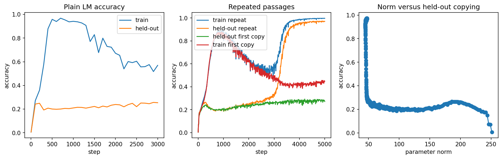
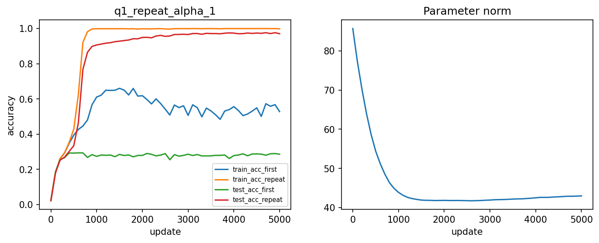

### Answers

**1. Plain next-character prediction.** The model fitted the small training set early: training accuracy was 94.1% at step 1,000, while held-out accuracy was only 21.0%. By step 3,000, these were 56.9% and 25.4%. The best held-out accuracy after training first crossed 90% was 25.7%, so I did not observe a later generalisation transition in this run. The falling training accuracy also shows that memorisation was not retained indefinitely under strong weight decay.

The circuit-efficiency explanation is that remembering 128 windows gives an immediate way to reduce training loss, whereas predicting unseen prose requires much more than a simple rule shared by those windows. In the repeated-passage task, a reusable copying solution is available within each input. Plain next-character prediction has no equivalent exact-copy solution for its unseen targets. This explains the difference between the two experiments, although the curves do not identify the actual learned circuits.

**2. Grokking signature and the control region.** I retained the prescribed seed-1337 baseline and used a separately recorded seed-0 run to obtain the submitted checkpoint pair. In the selected run, the supplied history helper first recorded 90% training-repeat accuracy at step **3,370**, and held-out-repeat accuracy crossed 80% at **3,400**. Its reported grokking gap is therefore **30 steps**. The original baseline had a 100-step gap and ended at 96.3% held-out-repeat accuracy.

The submitted earlier checkpoint is from step **690**. It meets the grader's separate 85% training criterion: training-repeat accuracy is **85.48%**, while held-out-repeat accuracy is **19.62%**. The final saved model reaches **97.01%** on held-out repeats, an improvement of **77.39 percentage points**. The earlier checkpoint step and the history helper's memorisation step differ because they use 85% and 90% thresholds, respectively.

Held-out first-copy accuracy remained low; it was 26.3% when repeats first crossed 80%, and the final saved model scored 29.1% on this control. The first copy must predict text that has not yet appeared in the input. The repeated half can use the first copy as context, so the large difference between these regions is evidence for copying rather than recall of the held-out passages.

**3. Weight decay and parameter norm.** In the selected run, the parameter norm was **45.125** when held-out-repeat accuracy first reached 80%. The norm-versus-accuracy plot shows that the improvement occurred after substantial norm reduction. In the controlled baseline comparisons, final held-out-repeat accuracy was **96.3% with WD=1**, but only **16.2% with WD=0** and **16.8% with WD=0.1** within the same training budget. Stronger decay therefore mattered in these runs. It can favour a compact shared solution over maintaining many passage-specific associations, but low norm alone is not proof that a particular circuit has formed.

**4. Training-set size.** The results below use the original baseline and its data-size ablations, rather than mixing the seed-0 checkpoint-selection run into the comparison.

| Training passages | First step with held-out repeats ≥80% | History gap | Final held-out-repeat accuracy |
|---:|---:|---:|---:|
| 64 | Not reached | Not defined | 18.4% |
| 128 | Not reached | Not defined | 26.6% |
| 256 | 3,900 | 100 | 96.3% |
| 512 | 2,000 | 0 | 99.1% |
| 1,024 | 1,400 | 0 | 99.2% |

The larger sets learned the copying behaviour sooner, and the 512- and 1,024-passage runs did not show a delay at the logged thresholds. This is consistent with [Varma et al.'s circuit-efficiency account](https://arxiv.org/abs/2309.02390): memorisation becomes more expensive as the dataset grows, while the cost of a shared generalising rule need not grow in the same way. The transition between 128 and 256 passages is an observation for this model and training budget, not an exact or universal critical dataset size.

**5. Initial scale.** With ALPHA=1, held-out-repeat accuracy reached 80% at step **800**, the history gap was **100 steps**, and final held-out-repeat accuracy was **97.0%**. A memorise-then-generalise phase was still visible at the logged thresholds, but generalisation occurred much earlier than in the ALPHA=3 baseline.

**6. First-copy memorisation after grokking.** Training first-copy accuracy fell from **85.1%** at the earlier checkpoint to about **42.6%** when held-out copying first crossed 80%, and was **44.7%** at the end of the selected run. There was substantial forgetting over the full trajectory, but it mostly preceded the 80% crossing. Accuracy fluctuated and did not show a sustained decline after that transition, so I would not claim to have demonstrated post-grokking ungrokking here. Weight decay could prune associations that no longer justify their parameter cost once copying becomes effective, but first-copy targets still contribute to the training loss. They continue to provide an incentive to retain useful language or passage-specific information.
