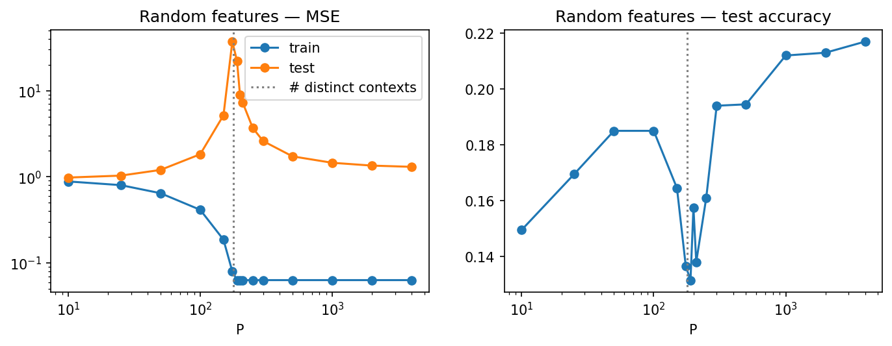
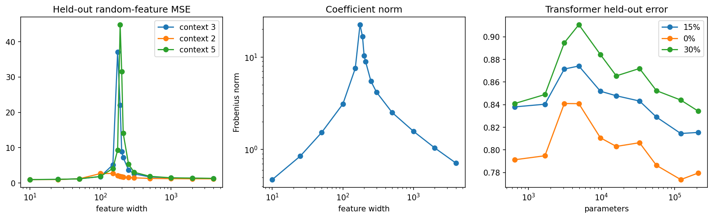
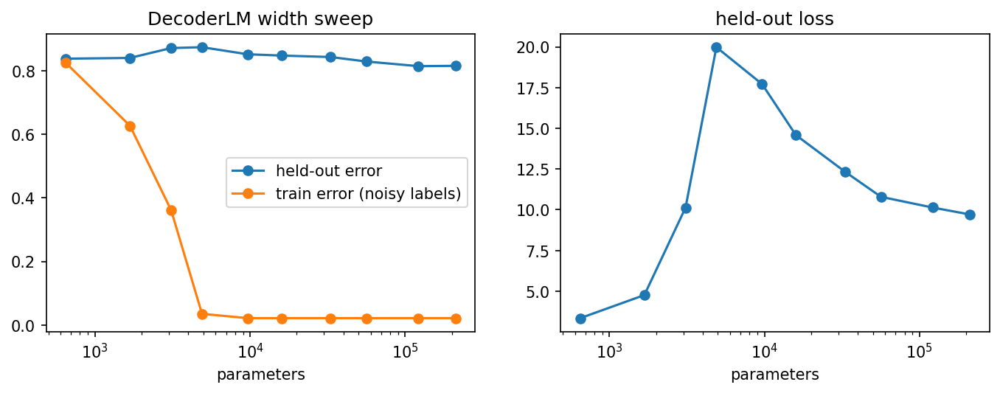
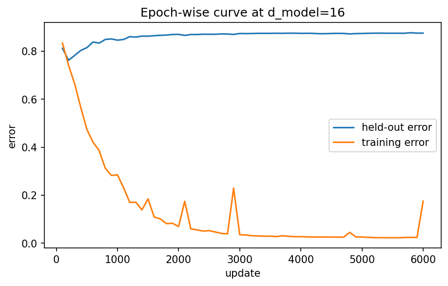

### Answers

**1. Location of the peak.** For context length 3, held-out MSE peaked at **175 random features**, close to the **179 distinct contexts** in the 200 training examples. Repeated copies of the same input produce the same feature row, so they do not add independent constraints. The relevant threshold is consequently the rank of the feature matrix, which is limited by the number of distinct inputs, rather than the raw example count. The width grid is discrete, so I would not expect its maximum to fall exactly at 179.

**2. Why the second descent occurs.** Close to the threshold, fitting directions associated with small singular values can require large coefficients and amplify noise. With more features, the pseudoinverse has more freedom to distribute the fit and selects the solution with minimum coefficient norm. In my experiment, the coefficient norm fell from **22.381** at the error peak to **0.714** at width 4,000. Held-out MSE fell from **37.038** to **1.305** over the same range. This supports the proposed connection between the unstable fit near the threshold and the second descent.

There is an important qualification: the training MSE settles near **0.0633**, rather than zero. Identical character contexts can have different next-character targets, which a deterministic predictor cannot fit simultaneously. The minimum-norm solution therefore fits their least-squares compromise; it does not remove that ambiguity.

**3. Effect of context length.**

| Context length | Distinct training contexts | Width at maximum held-out MSE | Maximum held-out MSE |
|---:|---:|---:|---:|
| 2 | 123 | 150 | 2.701 |
| 3 | 179 | 175 | 37.038 |
| 5 | 195 | 190 | 44.805 |

Longer contexts produced more distinct inputs and moved the observed peak towards larger feature widths. They also changed which target collisions remained and the conditioning of the sampled feature matrix. The peak became higher in these particular runs. Thus, although a longer context can reduce next-character ambiguity, it does not guarantee a smaller finite-sample error peak near a nearly singular fit.

**4. Transformer width and label noise.** With nominal 15% label noise, width **16** was the first tested model to exceed 90% noisy-label training accuracy: it reached **96.5%**. Held-out error was also worst there, at **87.4%**, before falling to about **81.5%** at width 128. The widest model fitted 97.9% of the noisy training targets, so the practical interpolation criterion was met even though the fit was not literally perfect.

| Label noise | Width with worst held-out error | Worst held-out error | Error at width 128 |
|---:|---:|---:|---:|
| 0% | 12 | 84.1% | 78.0% |
| 15% | 16 | 87.4% | 81.5% |
| 30% | 16 | 91.1% | 83.4% |

Increasing label noise made the error peak more severe and worsened the large-model result. The bump near the first well-fitting width is consistent with model-wise double descent, but the absolute held-out errors remain high.

**5. Epoch-wise double descent.** I continued width 16 to **6,000 updates**, recording held-out error every 100 updates. Its final error was **87.6%**, compared with **87.4%** at 3,000 updates. I did not observe a clear rise followed by a second fall of at least one percentage point in the recorded curve. [Nakkiran et al.](https://arxiv.org/abs/1912.02292) distinguish double descent over model size from double descent over training time; observing the former here does not require the latter to appear within this run.

