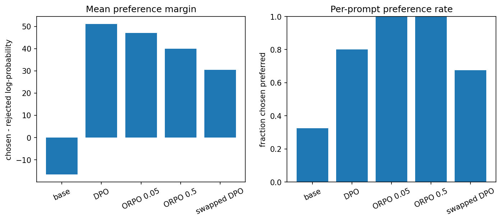

### Answers

**1. DPO as implicit RLHF.** DPO uses the policy's log-probability relative to a frozen reference as an implicit reward: up to a prompt-dependent constant, it is proportional to `beta * log(pi / pi_ref)`. The loss makes the chosen response's relative score larger than the rejected response's score. The reference provides a fixed baseline for the update and connects the objective to regularised reward maximisation. No separate reward model is fitted in this experiment. This is the interpretation developed by [Rafailov et al.](https://arxiv.org/abs/2305.18290).

**2. What the reference contributes.** A reference makes preference improvement relative to the starting model explicit. It helps constrain how the policy changes while fitting the comparisons, although it is not a guarantee of safety. ORPO instead combines a chosen-response likelihood term with an odds-ratio preference term, as described by [Hong et al.](https://arxiv.org/abs/2403.07691). Its supervised term supplies an anchor without a frozen reference. A possible failure is overfitting the supplied labels or response style while moving away from useful behaviour elsewhere.

**3. GRPO compared with PPO.** GRPO estimates advantages from the mean and standard deviation of rewards within a group of responses to the same prompt. It avoids training a separate value model, which reduces memory and critic-training work. Its clipped policy update can still limit large probability-ratio changes. The trade-off is that the learning signal depends on the sampled group: if all responses receive the same reward, the relative advantage is zero. Good relative rankings are useful, but do not establish that any response is good in an absolute sense. [Shao et al.](https://arxiv.org/abs/2402.03300) introduce this approach in DeepSeekMath.

**4. DPO and ORPO results.** All aligned models started from the same warmed-up base. DPO's prescribed 200-step baseline was retained, and its saved optimiser state was continued until the required preference rate was reached.

| Model/objective | Mean chosen-minus-rejected log-probability | Prompts preferring the chosen response |
|---|---:|---:|
| Base model | -16.611 | 32.5% |
| DPO, selected checkpoint | 51.124 | 80.0% |
| ORPO, lambda=0.05 | 47.071 | 100.0% |
| ORPO, lambda=0.5 | 40.045 | 100.0% |
| DPO with 10 reversed labels | 30.435 | 67.5% |

Both ORPO runs preferred the chosen response on every supplied record. DPO had the largest mean margin but a lower preference rate, showing that a few large margins and the fraction of positive margins describe different aspects of the result. The larger ORPO coefficient did not improve either reported measure over lambda=0.05 in this experiment. These are sequence log-probability comparisons on the 40 training records, not calibrated safety scores or a test of generated responses on unseen prompts.

**5. Reversing preference labels.** On the 10 reversed records, the mean margin evaluated using the original labels changed from **-24.670** in the base model to **-82.826** after swapped-label DPO. The policy moved further towards the responses that the original data marked as rejected. Its overall original-label preference rate was **67.5%**, compared with 80.0% for the normal DPO run. This makes the dependence on label quality clear: the objective follows the supplied comparisons, so incorrect preferences can train the opposite behaviour. It does not supply an independent definition of what is safe.
