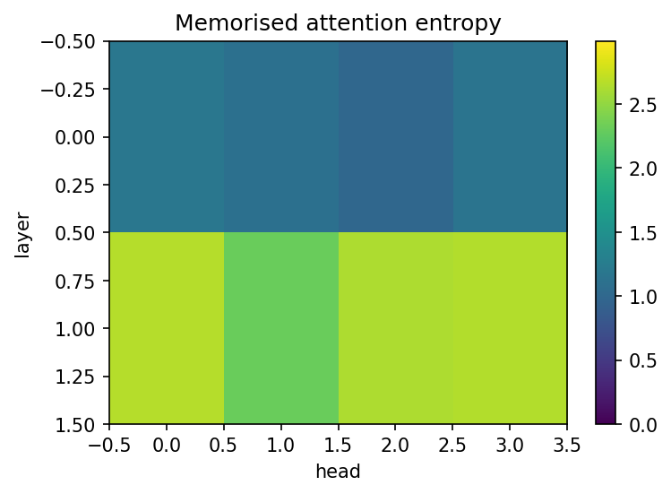
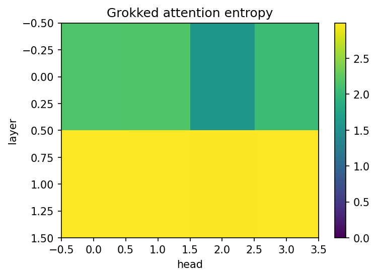

### Answers

The comparisons in Q4–Q6 use the submitted Q1 checkpoints and the first **256** held-out doubled passages. Q1's saved-model accuracy uses all **512** held-out passages, so its aggregate accuracy need not equal the subset accuracy below.

**Residual additions and the manual pass.** In the pre-LayerNorm toy block, attention reads the normalised input and its output is added to the incoming residual. The MLP then reads the normalised intermediate residual and its output is added a second time. These additions let each sublayer update a shared representation while retaining the existing signal. My trained A3 model uses post-LayerNorm ordering, so the port preserves normalisation after each residual addition.

For the toy model, I calculated embeddings, normalisation, causal attention, the MLP and both residual additions directly from the parameters. All seven requested tensors matched the corresponding cached activations within the required tolerance; the recorded maximum error for this toy batch was **0**. This checks the computation at intermediate points, rather than checking only the final logits.

**Entropy changes.** The largest absolute changes from the earlier checkpoint to the final checkpoint were increases:

| Head | Earlier entropy | Final entropy | Change, in nats |
|---|---:|---:|---:|
| L0H1 | 1.104 | 2.180 | +1.077 |
| L0H0 | 1.188 | 2.170 | +0.982 |
| L0H3 | 1.155 | 2.049 | +0.894 |

All eight heads had higher mean entropy in the final checkpoint. I therefore cannot describe this run as a general sharpening of attention during grokking. Entropy measures how spread out each attention row is; it does not say whether the attended values help predict the next token or whether a head is causally necessary. Those questions require the interventions in Q5.

**Why parity comes first.** A port with different scaling, positions, weights or normalisation could expose plausible-looking activations while computing a different model. On the 256-example analysis batch, the maximum absolute native-versus-ported logit error was **3.433e-5** for the final checkpoint and **3.242e-5** for the earlier checkpoint. Both are below **1e-3**, and both ports passed the supplied interface checks. This gives a numerical basis for interpreting their caches as those of the trained models.
