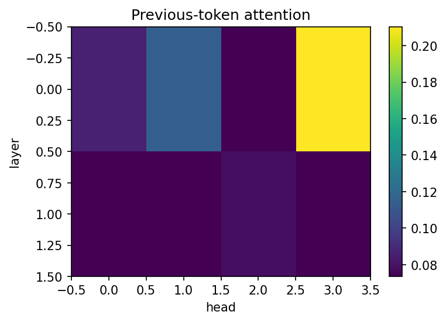
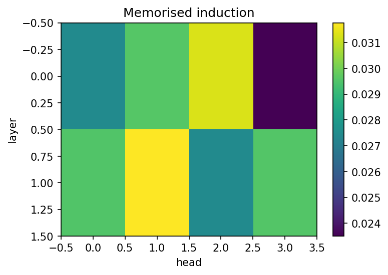
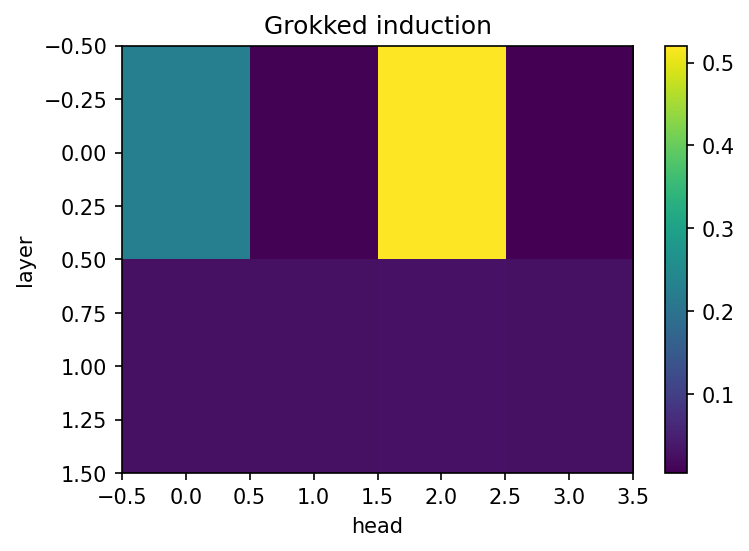
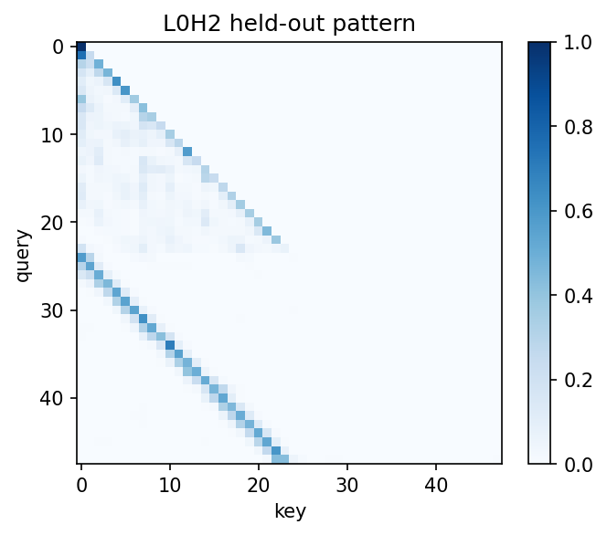
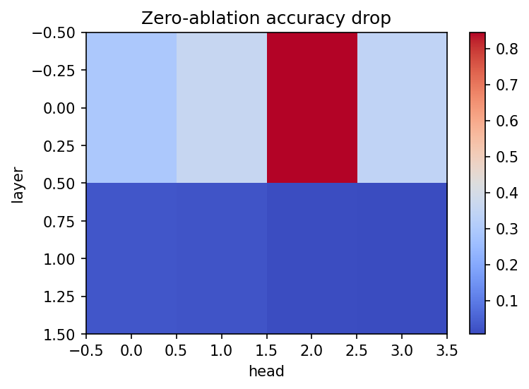
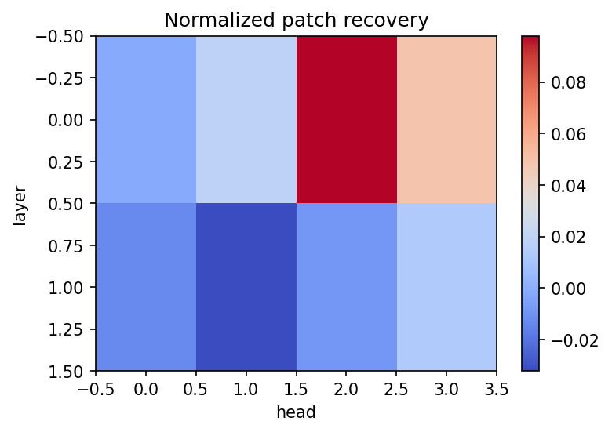
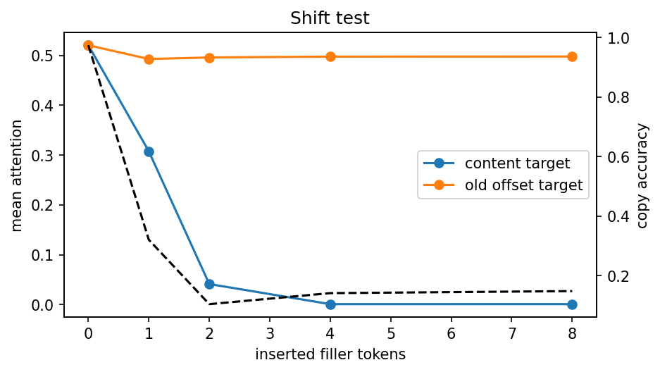

### Answers

**1. Selecting the candidate.** The maximum grokked induction score selected **L0H2**, with a score of **0.5203**. Its score in the earlier checkpoint was only **0.0313**; the earlier checkpoint's scores were all close to 0.03. In the final model, L0H0 also had an elevated score of 0.2267, but I kept L0H2 as the candidate throughout the later tests.

Layer-0 previous-token scores were **0.086, 0.114, 0.074 and 0.210** for heads 0–3. L0H3 had the strongest previous-token tendency, while the candidate itself did not. These observations do not establish a complete previous-token/induction circuit. Two endpoint checkpoints also cannot tell me exactly when the relevant behaviour formed.

**2. Zero and mean ablation.**

| Intervention on L0H2 | Held-out-repeat accuracy |
|---|---:|
| Intact model | 97.44% |
| Zero ablation | 12.94% |
| Mean ablation | 16.73% |

Zero ablation reduced accuracy by **84.49 percentage points**, the largest drop among the heads. This is strong evidence that the head matters for copying on these inputs. Mean ablation had a similarly large effect. The two operations answer slightly different questions: zero ablation removes the head's activation, whereas mean ablation substitutes one fixed vector computed across clean examples and positions. That mean removes input-specific information and may itself be an unusual activation, so neither intervention is automatically an on-distribution replacement.

**3. Patching.** The candidate's normalised patch recovery was **0.0979**, or about **9.8%** of the clean-versus-corrupt logit-margin difference under the specified per-example normalisation. A score near zero would mean little recovery, while a score near one would mean restoration of that margin. The modest recovery here does not contradict the large ablation effect: removing a head from a clean run and restoring one activation in a corrupted run are different interventions. Patching one head need not repair other corrupted representations or downstream interactions.

**4. Shift test.**

| Inserted tokens, k | Copy accuracy | Attention to content target | Attention to old offset target |
|---:|---:|---:|---:|
| 0 | 97.44% | 0.5203 | 0.5203 |
| 1 | 32.05% | 0.3075 | 0.4926 |
| 2 | 10.40% | 0.0412 | 0.4958 |
| 4 | 14.10% | 0.0008 | 0.4974 |
| 8 | 14.79% | 0.0009 | 0.4976 |

Once the repeated half was shifted, attention stayed close to the old offset target while attention to the correct content target collapsed. Accuracy also fell sharply. I interpret this as evidence that the head relies strongly on the training layout's fixed offset. Its high induction score on unshifted passages is therefore insufficient evidence for content-based copying that generalises across layouts.

**5. Why use a logit margin for patching?** Accuracy only records whether the largest logit crosses a decision boundary. A patch could increase the clean target's score substantially without changing the predicted token. The clean-minus-corrupt target margin retains that graded information and compares the same target IDs in all runs. The recovery score still describes this particular corruption and metric; it does not measure the fraction of an entire copying mechanism that has been explained.
