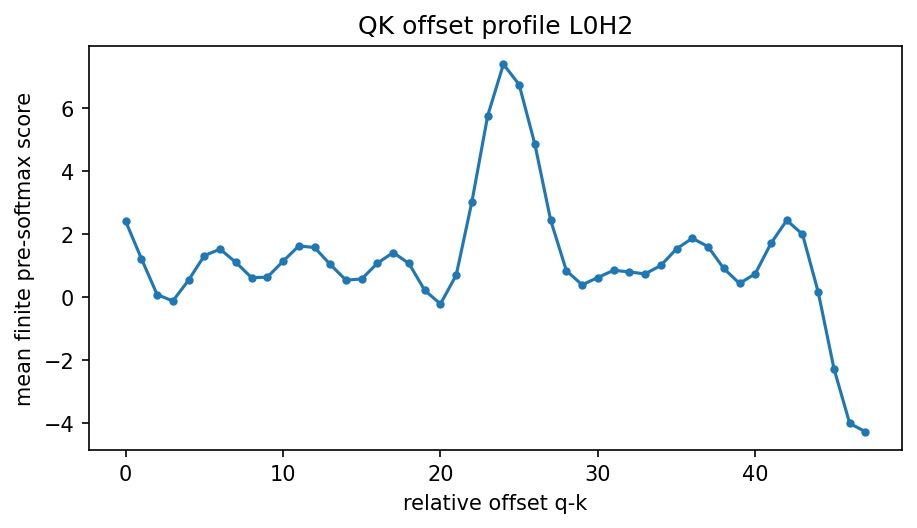
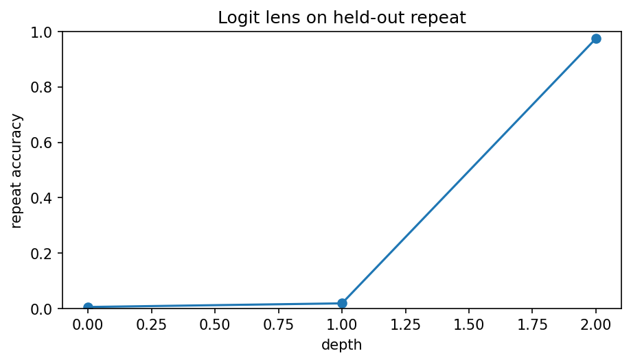
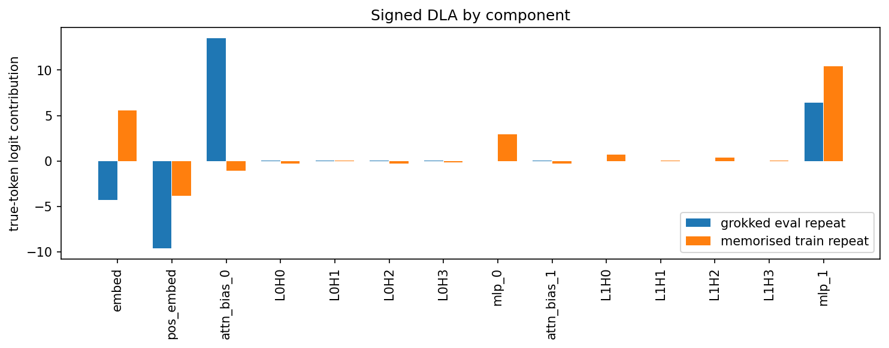

### Answers

**1. QK routing.** L0H2's largest mean finite QK score occurred at relative offset **q-k=24**, which equals the passage length. The mean score there was **7.3925**. This agrees with the shift test: when filler tokens moved the correct source location, the head continued to favour the original offset. The profile and perturbation together support a position-dependent explanation more strongly than an induction score alone would.

**2. What the head writes.** Over held-out repeated-half positions, the candidate's empirical residual write had mean L2 norm **0.4819**. Its mean signed direct contribution to the correct next-token logit was **+0.0589**. The positive sign means that, under the specified attribution convention, its observed write directly supported the true token on average. The norm describes magnitude in residual space; it is not a probability or a measure of causal importance.

**3. Logit lens.**

| Residual depth | Held-out-repeat accuracy |
|---:|---:|
| Embedding, depth 0 | 0.58% |
| After block 0, depth 1 | 1.89% |
| After block 1, depth 2 | 97.44% |

The final readout could decode the repeated targets accurately only after the second block. Information useful for copying may still exist earlier in a form that this readout cannot decode. The lens measures accessibility through the chosen readout, rather than locating a complete causal mechanism.

**4. DLA, ablation and patching.** The three measurements are not interchangeable. The candidate's **+0.0589 DLA** is a signed accounting term in the intact forward pass. Its **84.49-point ablation drop** includes all downstream consequences of removing the head. Its **0.0979 patch recovery** measures restoration of a particular clean-versus-corrupt margin. A small direct logit term can therefore coexist with a large behavioural effect if the head changes representations that later layers use.

| Evidence for L0H2 | Result |
|---|---:|
| Grokked induction score | 0.5203 |
| Intact repeat accuracy | 97.44% |
| Zero-ablation accuracy | 12.94% |
| Mean-ablation accuracy | 16.73% |
| Total zero-ablation accuracy drop | 84.49 percentage points |
| Normalised patch recovery | 0.0979 |
| Shift behaviour | Favours the old fixed offset |
| Preferred QK offset | 24 |
| Mean empirical write L2 norm | 0.4819 |
| Signed repeated-half DLA | +0.0589 |

**5. Comparing regions and checkpoints.** The candidate's mean DLA was **+0.0168** on first-copy positions and **+0.0589** on held-out repeated-copy positions in the grokked model. In the memorised checkpoint, evaluated on the specified training repeats, it was **-0.2914**. The sign and increase suggest that the head's contribution changed across training and became more supportive of copying. They do not establish causality, since the checkpoints, token regions and data differ.

The comparison also involves other components: the last MLP's repeated-half contribution was **+6.4156**, versus **+2.0729** on first-copy positions. The large term labelled `attn_bias_0` in the saved post-norm decomposition includes a normalisation correction; it should not be interpreted simply as a learned attention bias. Individual post-norm head terms depend on the supplied telescoping order.

**6. Exact reconstruction.** Let the final residual be the sum of component writes. With the final LayerNorm scale fixed to the scale measured on that residual, centring and projection are linear in those components. Their contributions can then be summed, with the final affine bias accounted for separately. Normalising each component independently would give it a different denominator, so those separately normalised values would not reconstruct the model's logit. The maximum reconstruction errors were **1.030e-4** for grokked held-out examples and **4.005e-5** for memorised training examples, both below **1e-3**.

**Mechanism synthesis.** L0H2 mainly routes information from a position 24 tokens earlier on the unshifted passages. Its empirical write has mean norm 0.4819 and a positive signed DLA of 0.0589 on the repeated half. Removing it causes an 84.49-point accuracy loss, while restoring it in the specified corrupted run gives only modest margin recovery. Shifting the second copy reveals that its routing remains tied to the old offset and copying accuracy deteriorates. Taken together, these results support an important fixed-layout copying role, while DLA, ablation and patching describe different aspects of that role.
