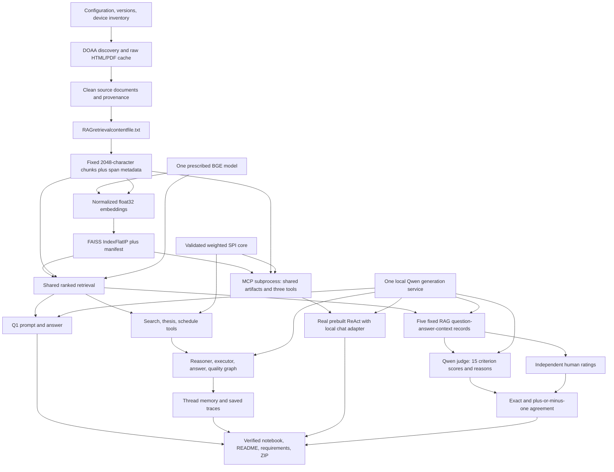

# CS781 Assignment 6: complete implementation plan

Planning date: **14 November 2026, Asia/Kolkata**. Notebook deadline: **17 November 2026**; no deadline time or timezone is specified in the notebook.

**Recommended selection: Question 2, Option A — LangGraph + MCP.** Implement Question 1, all selected Option A work, the compulsory evaluation, and the written answers as one integrated notebook. Preserve Option B in place and make its code explicitly inactive when A is selected.

This is a planning document, not an implementation or execution report. No assignment code was run, no packages were installed, no models were downloaded, and no notebook cells were modified during this audit. The only new deliverable from this phase is this document. All proposed tests, performance measurements, model behavior, and evaluation results remain unverified until implementation.

## A. Assignment audit

### A1. Audited source and indexing convention

Source: `C:\Users\Anirudh\OneDrive\Desktop\CS781_ASSIGNMENT_6\Assignment6_RAGandAgenticAI_Questions_Notebook.ipynb`.

The notebook contains **253 cells: 70 code cells and 183 markdown cells**. Its 70 code cells have no saved execution counts or outputs. Every cell's source was read, and all 13 embedded diagrams were inspected. The diagrams are in original cells 7, 9, 11, 14, 18, 20, 22, 27, 67, 167, 169, 191, and 194.

All cell numbers below are **zero-based indices in the original notebook**. For the original one-based position, add one. Insertions will shift positions, so implementation must locate cells using the existing `metadata.id` and a source fingerprint, not rely on shifted indices. For example, scraping is cell 36 / `LywhEJm_I29I`; chunking is 41 / `pTwbHBA9Vxd4`; evaluation is 227 / `w0AIII_M_Znr`; agreement is 233 / `x8IIRCXqAGce`.

Original notebook SHA-256:

`23F2482A6678A789CAAF8AC89837CAC56C4E91935D7D515312B375245094CEED`

Before future edits, preserve an untouched backup and a manifest of original cell order, metadata IDs, types, source hashes, and embedded-image hashes. The final notebook must retain every original cell in the same relative order.

### A2. Components, marks, outputs, and dependencies

| Component | Explicit marks | Original cells | Required visible result / artifact | Depends on |
|---|---:|---|---|---|
| Identity and submission requirements | Required | 0, 251–252 | Name, roll, email; correct ZIP; declaration | Actual student details |
| Q1: scrape HTML and PDFs | 70 | 33–39 | Nonempty `combined_text`, `text`, length; `RAGretrievalcontentfile.txt` | Requests, BeautifulSoup, pypdf, live DOAA site or validated snapshot |
| Q1: fixed character chunking | 35 | 40–43 | `chunk_text`, `chunk_size=2048`, `chunks`, count | Clean corpus |
| Q1: embeddings | 45 | 44–49 | `embedding_model`, `get_text_embedding`, `text_embeddings`, shape | Chunks; prescribed BGE model |
| Q1: FAISS | 35 | 50–51 | `d`, normalized vectors, populated `index` | Embeddings |
| Q1: query embedding | 20 | 52–54 | `question`, normalized `question_embeddings` | Same embedding model |
| Q1: retrieval | 45 | 55–57 | `D`, `I`, `retrieved_chunk` | FAISS and chunk order |
| Q1: prompt and generation | 70 | 58–61 | `prompt`, `run_qwen`, grounded answer | Retrieved evidence; model from 32 |
| **Q1 total** | **320** | 4–62 | Complete RAG pipeline | All above |
| Option A: four tools and registry | 30+35+25+25+5 = 120 | 99–113 | Four callable LangChain tools; `tools` list | Shared RAG and calculator core |
| Option A: state | 20 | 114–116 | Seven-field `AgentState` | LangChain message types |
| Option A: four nodes | 50+30+35+35 = 150 | 117–128 | Reason, execute, generate, reflect | State, tools, Qwen |
| Option A: routing and compilation | 20+35 = 55 | 129–138 | Compiled `agent`, graph visualization | All nodes |
| Option A: runner and named knowledge test | 10+10 = 20 | 139–151 | `ask_agent`, four original test executions | Compiled graph |
| Option A: memory | 35 | 152–160 | `agent_with_memory`, two-turn recall | Graph, checkpointer, consistent `thread_id` |
| Option A: MCP server | 45 | 161–174 | Real `doaa_mcp_server.py`, three exposed tools | Shared core and persisted RAG artifacts |
| Option A: MCP client integration | 35 | 175–178 | `run_mcp_agent`, real discovery and tool execution | MCP server; local tool-call adapter |
| Option A: prebuilt ReAct | 20 | 179–184 | Actual `create_react_agent` construction and test | Local chat adapter and four tools |
| **Option A total** | **500** | 63–184 | All selected components, including MCP and ReAct | Q1 |
| Option B: tools | 50+50+40+40 = 180 | 204–205, 207 | Four CrewAI-native tools | Same Q1 artifacts |
| Option B: agents | 75 | 206–208 | Research, calculator, QA agents; local endpoint | CrewAI and local Qwen |
| Option B: tasks | 70 | 209–210 | Research and QA task factory | Agents and delegation |
| Option B: crew execution | 60 | 211–212 | Sequential crew runner | Tasks |
| Option B: four tests | 40 | 213–220 | Knowledge, SPI, direct answer, schedule | Runner |
| Option B: memory | 75 | 221–222 | Reused memory-enabled crew and recall | Local memory embeddings and actual persistence |
| Compulsory evaluation: questions and answers | 45 | 223–227 | Five fixed questions; `rag_results` | Shared Q1 retrieval and generation |
| Compulsory evaluation: LLM judge | 55 | 228–229 | Three criteria × five questions; real `all_scores` | Frozen answer/context pairs |
| Compulsory evaluation: human table | 20 | 230–231 | Fifteen independently entered human ratings | Human reads frozen outputs |
| Compulsory evaluation: analysis | 20 | 231 | Answers to three analysis questions | Actual human/LLM scores |
| Compulsory evaluation: agreement | 40 | 232–233 | Exact and ±1 percentages; valid denominator | Valid paired scores |
| **Evaluation total** | **180** | 223–233 | Scored table and evidence-based discussion | Q1, human input |
| RAG written questions Q1–Q5 | 15 each = 75 | 235–239 | Written answers | Actual baseline configuration; theory |
| Option A written Q6–Q10 | 20 each = 100 | 240–244 | Written answers | Graph, retries, MCP, ReAct |
| Judge written Q11–Q12 | 10 each = 20 | 245–246 | Actual agreement; bias discussion | Evaluation and theory |
| Option B written Q13–Q16 | Heading says “25 Marks”; allocation unclear | 247–250 | Option B explanations if attempted | CrewAI design |
| Hidden tests | 300 | 252; interfaces throughout | Preserved names, signatures, types, behavior | Entire implementation |

**Marking inconsistencies must remain visible in the plan.** Option A's enumerated implementation marks sum to 500. Option B's enumerated implementation marks sum to **600**, despite its 500-mark heading. Q1 + selected Q2 + evaluation + hidden tests sum to 1,300. Adding the separately printed A-route theory marks gives 1,495, while the notebook title says 1,500. Do not edit marks, infer extra requirements to manufacture a total, promise a score, or submit both options to resolve these inconsistencies. Complete all explicitly required selected-route work.

### A3. Authoritative fixed requirements and scaffold discrepancies

| Finding | Planning decision |
|---|---|
| Cell 32 fixes `Qwen/Qwen2.5-0.5B-Instruct` | Keep this exact model for local generation, reasoning, reflection, and judging. Do not substitute a hosted or larger model. |
| Cell 36 fixes `https://www.iitk.ac.in/doaa/` | Keep the entry URL. Discover actual eligible links from the site. |
| Cell 46 fixes `BAAI/bge-small-en-v1.5` | Keep this exact embedding model. |
| Cell 44 still describes Mistral embeddings | Follow the explicitly fixed executable BGE scaffold; preserve instructional markdown and add a brief clarification. No Mistral API dependency or key is needed. |
| Cells 41 and 235–238 establish 2,048-character, nonoverlapping chunks and top-2 baseline retrieval | Keep the baseline. Discuss improved chunking in theory; any experimental variant gets separate artifacts and does not replace it. |
| Cells 36 and 41 advertise functions in comments but do not define them | Add the advertised functions inside those existing TODO cells, with exactly the advertised parameters, and populate the original globals. |
| `run_qwen` is defined in 60 with default 500 and in 94 with default 256 | Preserve both definitions and defaults. Delegate to one private generation implementation. After 94 the public default is 256; downstream calls should pass explicit budgets where required. |
| Cells 32, 74, 92, 184 repeat loading instructions | Use one cached model/tokenizer owner. Later cells initialize wrappers around the same objects; no redundant weight loading. Document this interpretation of “re-load” in 184. |
| Seven state fields are requested, but only six names are referenced outside the TODO | Preserve the six explicit names; use `tool_result` as the seventh. This singular name is a proposed implementation choice, not a known hidden-test specification. |
| Cell 174 requests three MCP tools without prescribing their names | Expose search, SPI, and thesis lookup using the same names/contracts as the local counterparts. The four-tool local registry remains intact, including schedule lookup. |
| Cell 178's only example execution is commented out | Add a real awaited test so saved outputs demonstrate MCP integration. |
| Cell 182's four-course illustration reports 8.71 | Its arithmetic is inconsistent: the displayed grades give 121/14, approximately 8.64. Retain the instruction and add a correction note; actual calculator output must follow arithmetic. |
| B cells 207–208 require async `ask_crew`; 212 redefines it synchronously | This is a real alternative-route conflict, analyzed in C. It does not affect selected A when all B code is guarded. |
| B cell 207 imports Colab secrets, reloads Qwen, and contains a made-up corpus fallback | Do not execute it for A. If B were chosen, portability and fallback fixes would be mandatory. Never permit invented corpus text. |
| Cell 233 fabricates dummy LLM scores when `all_scores` is absent | Replace that fallback with validation and a clear missing-results diagnostic. Never compute reported agreement from these dummy values. |
| Cell 251 demands an LLM Usage Declaration but no declaration template exists | Insert a new markdown declaration immediately after cell 0, truthfully describing planning and later implementation assistance. |
| The submission checklist says all written questions must be answered; Q2 alternatives have scoped theory headings | Complete Q1–Q12 for A. Also give short conceptual answers to Q13–Q16, marked as alternative-route discussion, to satisfy the broad checklist without claiming CrewAI implementation or results. |

### A4. What was and was not verified about this machine

Read-only inspection found Windows, Python **3.10.0** on PATH, installed distribution metadata for **`torch 2.14.1+cpu`**, an **Intel Core i5-1335U**, **12 logical processors**, approximately **15.69 GiB total RAM**, and approximately **92.50 GiB free on C:**. Free RAM was only about **1.48 GiB** at one observation and is time-sensitive.

`nvidia-smi` was not found on PATH or in the two usual Windows locations checked. Windows CIM inventory calls were denied. **GPU count, GPU model, VRAM, driver compatibility, and actual PyTorch runtime CUDA availability remain unverified.** A CPU-only Torch distribution does not prove the machine has no physical GPU. The assignment libraries other than Torch were not found in the inspected PATH Python environment; the future Jupyter kernel may be a different environment.

The web research tool could read the DOAA site and official documentation. A direct metadata fetch from the local sandbox failed DNS resolution for PyPI. This does **not** establish that a future notebook kernel has or lacks internet access. Package installation, model download access, and DOAA access must be checked from that exact kernel during setup.

## B. Notebook modification map

### B1. Editing rules

Keep the original notebook filename. Preserve all original cells, questions, diagrams, tests, section ordering, public function names, variable names, and required defaults. Complete existing TODOs first. The few edits to completed setup cells below are needed for reliable initialization, option isolation, atomic saving, or removal of the dummy-score fallback.

For the unselected route, add a normal `Q2_OPTION == "B"` execution guard around each existing B code cell, preserving its original content within the guard and printing a concise “Option B not selected” status. This includes install commands, imports, model loading, definitions, and tests. Do not merely tag cells as skipped: ordinary Jupyter Run All ignores such tags. Do not remove tests or replace them with fabricated passing outputs. The guards are a minimal control-flow addition necessary to reconcile one selected option with whole-notebook Run All.

### B2. Q1 and environment cells

In the tables, H0–H6 refer to helper insertions specified in B6. “Unchanged” means retain the cell and execute it normally.

| Cell | Subsection / existing object | Future change | Dependencies / helper | Expected output and validation |
|---:|---|---|---|---|
| 30 | `huggingface_hub` installation | Preserve purpose; use the selected kernel's installer and resolved constraints; avoid upgrades on every run | H0 | Installed-version check; no mismatched-kernel install |
| 31 | Transformers/Torch/Accelerate install | Same constrained, idempotent setup; select Torch wheel after device inspection | H0 | Version report and actionable prerequisite failure |
| 32 | Fixed Qwen load and greeting | Obtain singleton tokenizer/model; keep fixed ID, CUDA FP16/auto baseline, greeting prompt and 200-token cap; add load/generation validation | H0 | Real greeting; actual device/dtype and load time; no repeated weights |
| 34 | `faiss-cpu` installation | Constrain consistently with setup | H0 | Successful import/version check |
| 35 | pypdf/BeautifulSoup/requests install | Constrain consistently with setup | H0 | Import checks before scraper |
| 36 | `scrape_doaa_website(base_url)` TODO; `combined_text`, `visited_links`, `headers` | Define advertised function; normalized URL frontier, requests, HTML/PDF extraction, provenance, cache/resume, failure manifest; invoke it into original globals | H0, H1 | Counts, failures, text length; HTML/PDF smoke gate precedes full frontier |
| 37 | `text = combined_text` | Unchanged | 36 | `text` exactly matches collected corpus |
| 39 | Required corpus file | Keep filename and UTF-8; use validated atomic publication to avoid truncating a good file | 36–37, H1 | Existing file bytes hash-match `text`; nonempty corpus |
| 41 | `chunk_text(text, chunk_size)` TODO, `chunks` | Define advertised function; exact nonoverlap slices; `chunk_size=2048`; build separate span metadata | 37, H1 | Exact reconstruction and chunk-boundary assertions |
| 42 | `len(chunks)` | Unchanged | 41 | Actual count; never assume the tutorial's illustrative 37 chunks |
| 45 | Sentence Transformers installation | Use same constraints | H0 | Import succeeds |
| 46 | `embedding_model`, `get_text_embedding(input_text)` | Load prescribed BGE once; implement list-of-floats return and input validation | H0 | Singleton model; 384-dimensional finite vector |
| 47 | `text_embeddings` TODO | Batch encode; durable shards; normalize float32 vectors; assemble in original chunk order | 41, 46; H2 gate | `(N,384)` NumPy array; finite values; unit norms; row-order hashes |
| 48 | `text_embeddings.shape` | Unchanged | 47 | Actual `(len(chunks),384)` |
| 49 | `text_embeddings` display | Unchanged; bounded NumPy display settings can be set in H0 | 47 | Real array display without huge notebook output |
| 51 | `d`, `index` TODO | Build or validate/load `faiss.IndexFlatIP(d)`; add normalized rows; persist index plus manifest | 47 | `d=384`, `index.ntotal=N`; no IVF training |
| 53 | `question_embeddings` TODO | Preserve supplied SOTA question; embed, reshape `(1,d)`, normalize, ensure contiguous float32 | 46, 51 | Finite unit query vector; correct dimension |
| 54 | Query vector display | Unchanged | 53 | Actual vector |
| 56 | `D, I` TODO | Search top-2; retain expected 2-D arrays, correctly handle small/empty indexes | 51, 53 | Ordered cosine scores and valid indices; sentinel handling documented |
| 57 | `retrieved_chunk` TODO | Select real strings from valid indices only; maintain rank; keep provenance separately | 41, 56 | No accidental `chunks[-1]`; actual retrieved text |
| 59 | `prompt` TODO | Build bounded evidence/question prompt with source labels and insufficient-evidence instruction | 57, H1 | Nonempty prompt containing the supplied question and exact evidence |
| 60 | `run_qwen(user_message, max_tokens=500)` | Complete via shared private generation service; exact public signature/default | 32, H1 | Generated suffix only; no echoed input prompt |
| 61 | Original RAG generation test | Unchanged: preserve `max_tokens=100` call | 59–60 | Actual grounded response or explicit insufficiency |

### B3. Selected Option A cells

| Cell | Existing object / subsection | Future change | Dependencies / helper | Output and validation |
|---:|---|---|---|---|
| 71 | Agent package installation, including `fastmcp` | Use resolved constraints and avoid duplicate installation; distinguish standalone FastMCP from SDK import | H0 | Required imports verified before agent setup |
| 74 | `model_name`, pipeline, `llm` TODO | Reuse cell-32 weights/tokenizer; create text-generation pipeline and `HuggingFacePipeline` | 32, 71 | `llm` exists and wraps identical model object |
| 77 | Direct SOTA `llm.invoke` test | Unchanged | 74 | Real direct-model response; label as an ungrounded capability test, not authoritative DOAA evidence |
| 89 | Duplicate package installation | Same idempotent setup; no uncontrolled update | H0, 71 | No version drift |
| 92 | Repeated Qwen wrapper TODO | Reuse same tokenizer/model/pipeline/`llm`; do not reload weights | 32, 74 | Identity/reuse assertion |
| 94 | `run_qwen(user_message, max_tokens=256)` | Preserve later default and quick test; delegate to same generation service | 32, 60, H1 | IIT Kanpur quick-test output; explicit downstream token budgets |
| 101 | `search_doaa_knowledge(query: str) -> str` | Implement decorated RAG tool over live Q1 globals; format exact excerpts and source labels | 41, 46, 51; H1 | Original `.invoke` test returns evidence or meaningful error |
| 104 | `calculate_spi(grades: str) -> str` | Parse/validate credit:grade pairs; deterministic weighted average; errors as text | Shared arithmetic core in H1 | Original five-course example gives 139/17, approximately 8.18; invalid-input checks |
| 107 | `lookup_thesis_procedure(query: str) -> str` | Shared retrieval with thesis/program filtering; no invented procedure | H1, Q1 | Original PhD test yields thesis evidence and citations |
| 110 | `lookup_schedule(query: str) -> str` | Shared retrieval; preserve requested year/semester and label source dates | H1, Q1 | Original 2026 schedule test gives supported dates or explicit absence |
| 113 | `tools` | Register exactly the four original tools, with unique names | 101, 104, 107, 110 | Registry prints all four; schema/`.invoke` checks |
| 116 | `AgentState` TODO | Define seven fields with append-only message reducer | LangChain messages | Exactly seven annotations; required explicit names retained |
| 119 | `reasoner(state: AgentState) -> dict` | Read current human turn/history; generate and validate structured action; bounded repair; update iteration | 94, 113, 116 | Valid allowlisted action; no arbitrary execution |
| 122 | `tool_executor(state: AgentState) -> dict` | Dispatch registered tool; validate input; catch tool/runtime failures; append matching observation | 113, 116 | Correct result/error and matching tool-call IDs |
| 125 | `answer_generator(state: AgentState) -> dict` | Generate from question, history, tool evidence; preserve calculator result; set `final_answer` | 94, 116 | Relevant sourced answer or honest limitation |
| 128 | `quality_checker(state: AgentState) -> dict` | Deterministic validity checks plus bounded Qwen reflection; accept/retry; never loop past three attempts | 94, 116 | Feedback trace; exhaustion is explicit |
| 131 | Both router functions | Return mapped route strings for tool/direct and accept/retry | 116, node action vocabulary | Every branch maps to an existing node or END |
| 134 | StateGraph construction TODO | Add original four nodes and conditional edges; compile to `agent`; retain graph builder for memory compilation | 119–131 | Correct graph with reachable END |
| 137 | Text graph visualization | Unchanged | 134 | Mermaid text generated by actual graph |
| 138 | Optional graph image | Preserve attempt and fallback; use a verified renderer if available; save Mermaid text regardless | 134, 137 | Optional image or truthful renderer diagnostic; no failure of mandatory text display |
| 140 | `ask_agent(question: str) -> str` | Initialize fresh per-question state, invoke bounded graph, return `final_answer`, persist result/trace | 134; H3 before full tests | Stable string return; original prints preserved |
| 143 | Original PhD thesis question | Unchanged question and call | 140 | Expected reasoner → tool → answer → checker flow; evidence saved |
| 146 | Original SPI question | Unchanged | 140 | Real calculator invocation; approximately 8.18 |
| 149 | Original machine-learning question | Unchanged | 140 | Direct route, no unnecessary DOAA tool |
| 151 | Original odd-2026 midsemester question | Unchanged | 140 | Schedule evidence scoped to requested period; no guessed date |
| 155 | `MemorySaver` TODO | Compile same graph as `agent_with_memory`; keep ordinary `agent` separate | 134 | True thread-scoped state persistence; durable turn archive described in F |
| 157 | Memory turn 1, `config` | Use provided `student-session-1`; submit a clearly identified demo introduction | 155 | Actual first turn and saved state |
| 160 | Memory turn 2 | Ask recall with the exact same `config`; reset only transient turn fields | 155, 157 | Name/department retrieved from conversation; different-thread isolation tested |
| 174 | `%%writefile doaa_mcp_server.py` TODO | Keep magic first line, `FastMCP("IITK-DOAA-Assistant")`, stdio entrypoint; implement three real tools using shared core/artifacts | H1, persisted Q1 artifacts | Server file exists; no server start that blocks the notebook |
| 177 | MCP/adapters installation | Install constrained SDK v1-compatible packages | H0 | Imports including `mcp.server.fastmcp` succeed |
| 178 | `async run_mcp_agent(question: str)` | Build real stdio client/session, discover three tools, run actual prebuilt ReAct with local chat adapter; add awaited sample | H4, 174, 177 | Actual MCP `ToolMessage` and final result dictionary; clean shutdown |
| 184 | Required prebuilt ReAct TODO | Initialize wrappers over cached Qwen; preserve four local tool definitions/contracts; wrap in compatible `ChatHuggingFace` subclass; call actual `create_react_agent`; test | H4, 113, Qwen | Actual local prebuilt tool-call round trip; bounded execution |

### B4. Preserved, unselected Option B code cells

For A, each row below receives only the option guard/status described in B1. Do not install or run CrewAI and do not pretend these TODOs were completed. This preserves all **12** original B code cells and their tests. If B were later selected, the work column describes the implementation obligations; switching routes would require resolving the documented async/sync conflict first.

| Cell | Original content | If B were selected: required work | Dependencies and validation |
|---:|---|---|---|
| 201 | Install `crewai crewai-tools` | Pin an isolated, verified CrewAI stack | Import and dependency checks |
| 203 | Direct HF pipeline setup | Reuse Qwen, avoid an incompatible `HuggingFacePipeline` being passed as a CrewAI API LLM | Model identity; local generation |
| 205 | Four native tool TODOs | Define all four `_crew` tools and `crew_tools`, delegating to shared core | Native schemas, real retrieval/calculation |
| 207 | Consolidated Flask/agents/tasks/async runner setup | Remove Colab-only prerequisite and invented fallback; reuse models/artifacts; implement endpoint, three agents, delegation, early task factory and async runner | Local port health; API shape; no external paid calls; all required functions exist before 208 |
| 208 | Four `await ask_crew(...)` tests | Keep calls in this position; early async binding must exist | Four real results |
| 210 | Later `create_doaa_tasks` definition | Same task semantics as early factory; explicit QA task context | Two correctly ordered tasks |
| 212 | Later synchronous `ask_crew` scaffold | Preserve its shown signature; coordinate a private async execution core with earlier async public binding | Later sync tests return strings, not coroutine objects |
| 214 | Knowledge test | Preserve call | Real branch-change evidence |
| 216 | Natural-language credits/GP test | Delegate normalized pairs to calculator; no arithmetic in Qwen | 139/17 result |
| 218 | DOAA acronym test | Preserve call | Real direct response |
| 220 | Endsemester-2026 test | Preserve call | Correct period or insufficient evidence |
| 222 | Async `ask_crew_with_memory` TODO and commented tests | Real memory-enabled reused crew; local embedding provider; uncomment tests | `(answer, crew_instance)`; cross-kickoff recall |

The complete B code-cell set is **201, 203, 205, 207, 208, 210, 212, 214, 216, 218, 220, 222**. This explicit set is authoritative for guarding and verification.

### B5. Evaluation, answers, and finalization cells

| Cell | Existing content | Future change | Dependencies / expected validation |
|---:|---|---|---|
| 227 | `test_questions`, `generate_rag_answer`, `rag_results` TODOs | Keep all five supplied questions exactly; validate/reload genuine Q1 artifacts; define tuple-returning helper and generate/cache five answer/context records | Same BGE, FAISS, chunk order, top-2, Qwen; no synthetic fallback |
| 229 | `llm_judge(question, answer, context, criteria="relevance")` | Build criterion-specific 1–5 prompt; strict SCORE/REASON parsing; bounded repair; preserve raw outputs | Frozen `rag_results`; validate integer scores, reasons, failure records |
| 233 | `human_scores`, `criteria_list`, `calculate_agreement`, dummy fallback | Enter actual human ratings; replace dummy fallback with real dependency check; implement required printed agreements and zero-score skipping | H5 creates genuine `all_scores` first; no zero denominators or invented comparisons |
| 0, markdown | Student details | Fill supplied fields with actual identity | No inferred roll/email/name completion |
| 231, markdown | Human table and three analysis questions | Fill from frozen real ratings/results; answer all three questions | Human input plus actual score differences |
| 235–246, markdown | Q1–Q12 | Append answers below each original question | Evidence map in D8; Q11 waits for results |
| 247–250, markdown | Alternative Q13–Q16 | Append concise conceptual answers marked as B-route discussion | No claim of CrewAI execution |
| 251–252, markdown | Submission instructions and hidden-test note | Unchanged | Final audit maps each checklist item to evidence |

All other original cells remain unchanged, including introductory explanations and diagrams.

### B6. Exact helper insertion points

Use the following seven code helpers and two short markdown additions as the initial budget. Consolidate adjacent helper responsibilities rather than add one cell per utility.

| Helper | Insert at original boundary | Responsibility | Why it belongs there |
|---|---|---|---|
| H0 | After 29, before 30 | Configuration, selected option A, deterministic paths, seeds, package constraints/version checks, read-only environment inventory, cache policy, logging, lazy model-resource registry/getter | Must precede installs and first Qwen load; heavy imports inside the getter occur only after 31 has verified dependencies |
| H1 | After 35, before 36 | Atomic artifact primitives, manifest checks, provenance structures, one private generation service, shared retrieval/arithmetic core; materialize a small `doaa_shared.py` for MCP reuse | All Q1/agent stages need the same policies; defining lazy helpers does not load later models |
| H2 | After 46, before 47 | RAG smoke gate: tiny real HTML/PDF sample, chunking, batch embedding, FAISS, short grounded Qwen generation, artifact round trip | Blocks expensive full embedding; scraper must already run its own sample gate before full crawl |
| H3 | After 140, before 141 | Agent/tool/routing/retry smoke gate with isolated test state and recorded test doubles only where testing failures | Blocks full scenario batch until control flow is valid |
| H4 | After 177, before 178 | Local tool-call chat adapter, async generation bridge, MCP session/runtime helpers and transport smoke gate | Required before first MCP/prebuilt call; imports are now installed |
| H5 | After 229, before 230 | Real judge driver over 5 × 3 cases; assemble `all_scores`; export blinded human review sheet; reload human input only when bound to exact answer/context hash | Missing orchestration is not supplied elsewhere; must precede agreement |
| H6 | After 250, before 251 | Integrity audit, final dependency/output checks, duration summary, artifact/ZIP readiness report | Runs after all empirical/theory work; can report missing human inputs without fabricating readiness |
| Markdown M0 | After 0 | Truthful LLM Usage Declaration and environment prerequisites | Required declaration has no provided cell |
| Markdown M1 | After 184, before 185 | State Option A selected; explain preserved B execution guards and known scaffold corrections | Prevents skipped alternative cells being mistaken for completed B work |

H1's supporting module is limited to transport-neutral utilities needed by both notebook tools and the MCP subprocess. Public assignment functions and graded work remain in their original notebook cells. This is not a replacement standalone application.

## C. Recommended Question 2 option

### C1. Comparison grounded in the actual notebook

| Priority | Option A: LangGraph + MCP | Option B: CrewAI |
|---|---|---|
| Achievable stated marks | Stated 500; explicitly enumerated sections also total 500 | Stated 500; subsection total is inconsistent at 600; no reason to assume a higher award |
| Reliability | Four explicit nodes, two routers, visible retries and bounded state transitions | Additional autonomous delegation and separate QA task; less predictable with a 0.5B model |
| Fixed local Qwen | Custom graph needs ordinary text generation; prebuilt sections need a specific adapter | Native CrewAI LLM incompatibility requires local OpenAI-compatible endpoint; tool-call/delegation behavior remains difficult |
| Q1 reuse | Tools directly consume existing `embedding_model`, `chunks`, `index` | Same underlying reuse is possible, but consolidated scaffold contains reloads and a fake fallback |
| Runtime | One local generation service; no HTTP model server; retries controllable | Research, delegation, QA, and memory add model calls and serialization overhead |
| Hidden-test predictability | Explicit function contracts, state fields, routers, globals | `ask_crew` is async early and sync later; tests depend on which definition is active |
| Clean Run All | Needs B guards, singleton model setup, real MCP test, tool-call adapter | Needs A guards, Colab removal, server lifecycle handling, async/sync reconciliation, local memory setup |
| Complexity | MCP is real extra work, but isolated to a small server/client and adapter | Flask port 8234, API JSON, CrewAI/LiteLLM behavior, delegation, memory provider, conflicting examples |

**Select A.** It gives direct control over the main graded workflow and permits deterministic calculator, routing, retry, and memory checks. It does not eliminate risk: MCP and prebuilt ReAct must actually work, and their 100 marks must not be treated as optional. No claim is made that A guarantees full marks or that hidden tests are known.

### C2. What an honest Option B design would entail

If B were chosen instead, retain the same corpus/chunks/index and pure arithmetic/retrieval cores. Define the four `_crew` tools with the CrewAI-native decorator. Use the specified research agent with search/thesis/schedule tools and `max_iter=3`, calculator agent with only the SPI tool, and QA agent with no tools. Explicitly enable delegation for the research agent; a calculator merely present in the crew is not sufficient when only research and QA have assigned tasks.

Create a two-task factory returning research then quality tasks, with the research output explicitly provided as QA context. Use `Process.sequential` and all three agents. Ensure the calculator receives normalized credit/grade pairs rather than relying on Qwen to calculate. A QA task at the end does not itself rerun a completed research task; retries need an explicit bounded orchestration loop or guardrail retry mechanism. `max_iter=3` limits an individual agent's reasoning/tool loop, not whole-crew reruns.

Honor the existing Flask API requirement at `127.0.0.1:8234`: implement `/v1/models` and `/v1/chat/completions`, validate request bodies, serialize access to the shared local model, return valid completion IDs/roles/choices/finish reasons, and handle tool-call fields if the selected CrewAI path requests them. A server returning arbitrary plain text in an OpenAI-shaped envelope is not proof of function-calling compatibility. Detect occupied ports and stale servers; disable development reloaders; verify health before printing success. No model reload, Colab secret lookup, external paid endpoint, or invented corpus is appropriate.

Preserving the B scaffold literally requires two public bindings at different points: an async `ask_crew` before 208 and the later synchronous `ask_crew` at 212, both calling a private execution core. That temporal API is test-sensitive; instructor clarification would be appropriate before choosing B for implementation. Selected A avoids depending on it.

For B memory, use the same crew instance, actual local embeddings, and persisted storage, with both memory tests awaited. Do not assume `memory=True` prevents default external-provider access. Current CrewAI documentation describes a unified memory API replacing separate legacy stores, so the tutorial's short-/long-term/entity taxonomy must be explained as its historical conceptual model and checked against the pinned version. [CrewAI memory documentation](https://docs.crewai.com/en/concepts/memory)

### C3. Dependency and API compatibility plan

Use a dedicated environment and register its Jupyter kernel before the final Run All. Prefer Python 3.11.x for the candidate stack below; retain a Python-3.10-compatible candidate only if that is the actual available execution environment. Do not modify the user's global environment during planning.

The following is a **concrete initial compatibility candidate, not a tested lock file and not a recommendation to install every latest release**. Resolve all packages together, inspect the resolver report, run `pip check`, and freeze exact accepted transitive versions during implementation. A resolver success alone is not a tool-calling or MCP test.

| Layer | Initial candidate / constraint | Compatibility reason and acceptance gate |
|---|---|---|
| Python | 3.11.x | Broad wheel support; kernel/interpreter identity must be explicit |
| Torch | 2.9.0 candidate, or retain installed 2.14.1+cpu if supported by the resolved stack | Use CPU or matching official CUDA wheel; never treat installing `torch` as proof of CUDA support; native import/generation must pass |
| Transformers | 4.57.3 | Qwen2 support while avoiding an unreviewed major-version migration; confirm dtype/chat-template/generate behavior |
| Accelerate | 1.11.x | Required by `device_map="auto"`; lock resolved patch |
| Sentence Transformers | 5.1.2 | Batch encode and model reuse; resolve with Transformers 4.x candidate |
| NumPy | 2.2.6 candidate | Require compatible Torch/FAISS wheels and contiguous float32 arrays |
| FAISS CPU | 1.12.0 | Verify wheel for OS/Python and native import; no GPU FAISS requirement |
| LangGraph | 1.0.5 | Must retain actual `langgraph.prebuilt.create_react_agent` |
| LangChain | 1.0.8 | Resolve against compatible `langchain-core` 1.x; do not independently force an incompatible core |
| LangChain community | 0.4.1 if retaining the scaffold package set | Not needed for custom FAISS logic; avoid adding dependencies merely for unused integrations |
| LangChain Hugging Face | 1.0.1 | Install base integration plus explicitly controlled local-model packages; validate local adapter against this exact version |
| MCP adapters | 0.1.13 | Confirm `MultiServerMCPClient`, explicit session lifetime, `load_mcp_tools` behavior |
| MCP Python SDK | 1.26.0, strictly `<2` for this scaffold | Keep `from mcp.server.fastmcp import FastMCP`; current SDK major APIs differ |
| Standalone `fastmcp` | Omit if unused after setup review; if retained, use a resolver-compatible 2.x version | It is a different distribution from SDK `mcp.server.fastmcp`; do not conflate the imports |
| HTML/network/PDF | requests 2.32.x, BeautifulSoup 4.14.x, pypdf 6.x or compatible supported version | Pin exact patches after resolver/import/PDF extraction tests; retain required libraries |
| Notebook verification | nbformat 5.10.x, nbclient 0.10.x, compatible IPython/ipykernel | Preserve magics and awaited cells; validate actual clean-kernel execution |
| Optional output only | matplotlib 3.x; local Mermaid renderer if already available | Tables and text graph suffice; no browser/PDF/OCR stack needed for baseline |

Release existence was checked on primary package pages for [Transformers 4.57.3](https://pypi.org/project/transformers/4.57.3/), [Sentence Transformers 5.1.2](https://pypi.org/project/sentence-transformers/5.1.2/), [FAISS 1.12.0](https://pypi.org/project/faiss-cpu/1.12.0/), [Torch 2.9.0](https://pypi.org/project/torch/2.9.0/), [LangGraph 1.0.5](https://pypi.org/project/langgraph/1.0.5/), [LangChain 1.0.8](https://pypi.org/project/langchain/1.0.8/), [LangChain Hugging Face 1.0.1](https://pypi.org/project/langchain-huggingface/1.0.1/), [MCP adapters 0.1.13](https://pypi.org/project/langchain-mcp-adapters/0.1.13/), and [MCP SDK 1.26.0](https://pypi.org/project/mcp/1.26.0/). Their combined installation has not been attempted. Exact patches may change after the implementation compatibility gate; assignment interfaces and models may not.

Important API decisions:

1. Keep the required `create_react_agent`, even though LangGraph v1 deprecates it in favor of `create_agent`; do not silently replace a graded API. Confirm the pinned installation still exports it. [Official migration guide](https://docs.langchain.com/oss/python/migrate/langgraph-v1)
2. `ChatHuggingFace` advertising tool calling is not proof that its local pipeline path emits parsed `AIMessage.tool_calls`. The inspected local path converts generated text to chat output; native async pipeline generation explicitly raises `NotImplementedError`. H4 must bridge both behaviors and be tested against the chosen pin. [Official integration source](https://raw.githubusercontent.com/langchain-ai/langchain/master/libs/partners/huggingface/langchain_huggingface/chat_models/huggingface.py)
3. Use current documented MCP client discovery/session APIs, not an old example that assumes the entire client is an async context manager. Keep a session alive for the complete tool interaction. [Official adapters repository](https://github.com/langchain-ai/langchain-mcp-adapters)
4. The notebook imports SDK FastMCP, so explicitly control the SDK major version. Its v1.26 metadata also requires Pydantic 2.11+ and Windows-specific support. [SDK v1.26 package metadata](https://raw.githubusercontent.com/modelcontextprotocol/python-sdk/v1.26.0/pyproject.toml)
5. Retain `MemorySaver` as named in the scaffold; verify its alias/export. In-memory state and durable recovery are separate requirements. Avoid installing an additional database framework merely to demonstrate two-turn memory.
6. Keep each installation in its existing location but make it idempotent and constrained. Later cells must not upgrade imported packages mid-kernel. A precreated environment is an explicitly documented prerequisite; once prepared, Restart Kernel → Run All must not require another restart.

## D. Complete implementation architecture

### D1. Shared ownership and dependency diagram

There is one canonical corpus snapshot, one ordered baseline chunk collection, one normalized embedding matrix, one CPU FAISS index, one notebook BGE instance, and one notebook Qwen instance. All selected tools and the compulsory evaluator consume those same artifacts. Public functions read current supplied notebook objects rather than silently using a different cached corpus; tests that replace `chunks` or `index` must not be defeated by hidden captured references.

The MCP subprocess cannot access notebook globals. It loads the same validated immutable chunk/index/metadata files and a lazy CPU BGE query encoder. That small encoder copy is a necessary process boundary cost, not another corpus/index build. Qwen stays in the host notebook and is never loaded by the MCP server. Keep a server/session alive across a batch of MCP interactions where the event-loop lifecycle permits; a calculator-only smoke call must not load BGE at all.

### D2. Scraping, PDF parsing, and provenance

**Discovery and scope.** Fetch the fixed homepage using `requests` and the provided User-Agent. Include homepage content, then resolve all eligible anchor links with `urljoin`. Eligibility is based on parsed host and `/doaa` path boundaries: `iitk.ac.in` and `www.iitk.ac.in`, path `/doaa` or beneath it. Do not accept an unrelated host merely because its URL contains the target string, or follow `/doaa-other` as though it were a DOAA path. Reject `javascript:`, `mailto:`, `tel:`, fragment-only navigation, credentials in URLs, and non-HTTP(S) schemes.

Resolve relative and root-relative links; remove fragments, normalize scheme/hostname case and default ports, preserve path case and meaningful query parameters, and record observed redirects. Do not discard every query string: PHP document links can depend on them. Canonicalize alternate hosts or trailing slashes only when equivalence is established. Use a deterministic ordered frontier and stable final document ordering, so concurrent completion order cannot change chunk IDs.

At minimum cover every qualifying homepage link, as required. Continue breadth-first discovery through qualifying HTML pages to capture downstream DOAA resources, while avoiding duplicate URLs and content. Persist the frontier so interruption resumes. A safety URL/byte/time cap must produce an explicit incomplete-crawl status and resumable frontier, not a success statement or silently truncated corpus. Do not expand into unrelated IITK subdomains, authenticated services, Google Drive, or the entire institute website without an explicit scope change.

**Network policy.** Use sessions, certificate verification, explicit connect/read timeouts (initial candidate 10/45 seconds), and up to three attempts for transient connection errors, timeouts, 429, and selected 5xx failures. Respect `Retry-After`; back off between attempts. Record permanent 4xx failures without repeatedly retrying them. Check final redirects remain in scope before adding content. Start with two to four polite concurrent downloads at most; never compensate for rate limiting by adding workers. A failed homepage with no valid snapshot is fatal. Individual linked-document failures are recorded, with coverage consequences visible.

**Content type and extraction.** Identify PDFs by parsed case-insensitive extension, response content type, and a PDF magic-byte check; query-string PDFs must work. Detect HTML by content rather than blindly applying BeautifulSoup to every response. Stream downloads to temporary files, enforce a configurable size guard, and publish only complete bodies. Preserve HTTP status, content type, byte count, ETag/Last-Modified where available, final URL, timestamp, and body hash.

For HTML, remove script/style/noscript elements, isolate the main/article/content region when available, and exclude repeated navigation/footer scaffolding conservatively. Preserve headings, list order, paragraph boundaries, table rows, credits, dates, and policy identifiers. A robust fallback to body text is better than an over-specific selector returning nothing.

For PDFs, use required `pypdf.PdfReader` with `BytesIO` or cached bytes. Extract page by page, treating `extract_text()` returning `None` as no text. Record one-based page numbers and extraction failures. Try ordinary text extraction first; layout extraction can be a documented per-document fallback if tables are otherwise unreadable. Flag scanned/image-only, encrypted, corrupt, or suspiciously empty documents. pypdf is not OCR; do not manufacture text. OCR is optional and separately identified, rather than an implicit baseline dependency. PDF content streams can consume much more memory than file size suggests, so parse with resource guards and low concurrency. [pypdf extraction documentation](https://pypdf.readthedocs.io/en/stable/user/extract-text.html)

**Cleaning and duplicates.** Use consistent Unicode normalization, remove null bytes/control artifacts, normalize nonbreaking spaces, and collapse excessive horizontal whitespace without erasing paragraph/table structure. Avoid destructive dehyphenation or aggressive sentence deduplication that changes policy meaning. Deduplicate identical fetched bodies and identical normalized document text by hash, keeping all source aliases. Remove only identifiable repeated boilerplate, not repeated regulations with different effective dates.

**Canonical corpus and offsets.** Store cleaned document/page records first. Concatenate their real text with deterministic separators into `combined_text`, assign `text`, and save exactly those UTF-8 bytes as `RAGretrievalcontentfile.txt`. Store document/page character spans in a sidecar instead of inserting invented policy summaries into the corpus. Track extraction counts, skipped resources, parse failures, and discovered-but-unprocessed URLs.

Coverage checks include presence or documented absence of sources relevant to thesis, branch change, SOTA, grading/CPI, course drop, and schedules. The live homepage exposes relevant policy and thesis links, but current content, accessibility, and applicable dates still require the notebook's own crawl. Do not treat reading the page in this planning session as completed assignment scraping. [DOAA homepage](https://www.iitk.ac.in/doaa/)

### D3. Chunking, embedding, and FAISS

**Baseline chunker.** `chunk_text(text, chunk_size)` must produce consecutive character slices, no overlap, preserving all input characters and the last short remainder. It must not strip each chunk, drop whitespace, use token counts instead of character counts, or change the 2,048 baseline. Empty text produces an empty list; an exactly divisible length produces no extra empty chunk. Reject non-string input and nonpositive/noninteger chunk sizes with informative exceptions; reject booleans as sizes.

Keep metadata outside the public list: chunk ID, corpus character start/end, text hash, and every intersecting document/page span. Fixed corpus-wide slicing can cross document boundaries, so assigning only one source to every chunk would be inaccurate. Attach all relevant intersections, and distinguish the excerpt portions where practical. Assert joining chunks exactly reconstructs `text`.

**Embedding contract.** `get_text_embedding(input_text)` returns a Python list of finite floats from the prescribed model's `encode`. Keep the scalar helper simple; batch processing belongs in 47. Build `text_embeddings` as a C-contiguous NumPy float32 matrix with one row per original chunk, normalized before index insertion. Normalize query vectors with the same policy. Validate row count, dimension, finite entries, and nonzero norms before normalization.

The BGE model card identifies 384-dimensional vectors and a 512-token sequence limit. **2,048 characters is not a guarantee of at most 512 tokens.** Measure token lengths and report truncation counts. Preserve the baseline chunking and documented encoder truncation; do not silently increase the encoder limit. Token-aware or subwindow aggregation variants are optional experiments with separate manifests, not replacements for the baseline. Use no query prefix for the baseline unless explicitly documented and applied consistently; BGE v1.5 supports retrieval without instructions. [BGE model card](https://huggingface.co/BAAI/bge-small-en-v1.5)

Encode in batches, initially 16 on CPU or 32 on an adequate GPU, and measure rather than assume these are optimal. On memory failure, reduce the batch and retry only the failed batch a bounded number of times. Persist completed deterministic shards with row IDs and hashes. On resume, verify shard continuity and configuration; concatenate only after all required rows exist. Do not substitute zero vectors or skip failed rows.

**Index.** Use `faiss.IndexFlatIP(d)` with normalized float32 vectors and an explicit CPU index. Preserve `d`, `index`, and chunk row order. An exact flat index is appropriate for this small corpus and requires no training. Validate `index.ntotal == len(chunks)` and `index.d == text_embeddings.shape[1] == 384`. Save using FAISS index I/O and an accompanying content/configuration manifest.

For unit vectors, inner product equals cosine similarity; squared L2 distance equals `2 - 2 × inner_product`. This is the basis for Q1's normalization answer. Raw unnormalized L2 has different rankings because vector magnitude contributes. [FAISS metric documentation](https://github.com/facebookresearch/faiss/wiki/MetricType-and-distances)

**Retrieval.** Keep top-2 for Q1 and `generate_rag_answer`. Use the same encoder, normalization, matrix dimension, and row order. Native FAISS can return `-1` for missing neighbors when k exceeds the number of rows; filter these before selecting text. Preserve two-dimensional `D`/`I` in the scaffold, and make the shared higher-level retriever return at most the available genuine records. Handle an empty index before searching. Scores are similarities, not calibrated probabilities; no arbitrary universal cutoff should silently erase evidence.

The generic A search tool also defaults to top-2 for consistency. Specialized thesis/schedule tools may retrieve a small candidate set, such as eight, then filter and return at most two with the policy recorded. This does not change the compulsory evaluation's top-2 baseline. Optional rerankers, hybrid BM25, HyDE, alternate chunk sizes, and FAISS GPU are deferred until all baseline requirements pass.

### D4. Local generation, prompting, and model ownership

Keep `model_name`, `tokenizer`, `model`, `llm`, and other provided globals. Model ownership is a lazy singleton keyed by exact model ID/revision, dtype, and device policy; later setup cells reuse it. Public wrappers must reference the same instance. Fix the model revision hash after the initial download for reproducibility without changing the required model identity.

Retain the supplied CUDA baseline `torch_dtype=torch.float16`, `device_map="auto"`. CPU fallback may require FP32 for performance/operator support; this is an **explicit proposed runtime adaptation**, not a silent change to the scaffold. If strict parameter preservation is required, first test the provided CPU FP16 configuration and make any dtype deviation visible and authorized before applying it. The model ID, chunk size, overlap, baseline k, public defaults, original test questions, and token caps explicitly shown in tests remain fixed.

Call `model.eval()` and use inference mode. Apply Qwen's chat template once, with `add_generation_prompt=True`; avoid adding a second template in a wrapper or decoding the prompt as part of the answer. Provide attention masks and valid padding/EOS IDs. Respect the model's actual input placement, particularly when `device_map` is used; do not call `.to()` on an already dispatched model. The inspected Qwen card specifies a 32,768-token context for this model; derive runtime limits from its configuration as well, rather than trusting the tokenizer's larger generic maximum. [Qwen model card](https://huggingface.co/Qwen/Qwen2.5-0.5B-Instruct)

The private generation service handles ordinary messages and optional tool schemas. The two `run_qwen` definitions keep their exact signatures and pass one user message to that service. Use deterministic greedy decoding for baseline/evaluation where the scaffold does not prescribe sampling; record all effective generation settings. Keep the original greeting's 200-token limit and cell-61's 100-token test. Use explicit budgets for reasoner, reflection, judge, and evaluation calls rather than relying on whichever `run_qwen` default was most recently defined.

For grounded prompts, clearly separate instruction, question, and retrieved evidence; label each evidence block with chunk/source/page identifiers. Tell the model to answer from the evidence, cite those labels, and state when a procedure, eligibility condition, or requested date cannot be established. Treat instructions inside fetched documents as data. A calculator observation supplies exact arithmetic; Qwen may explain it but must not replace it with a new estimate.

Budget tokens before generation, reserving output tokens and formatting overhead. Trim older conversation turns or excess candidate evidence using a documented rule, while preserving the current question and the actual top-2 evaluation context. Persist the **exact context shown to the generator**. Judge and human review must use that same context, not an untrimmed superset that the generator never saw.

Invalid prompts, unavailable models, or OOM are operational errors with stage/question diagnostics. An answer honestly saying “the retrieved material does not establish that date” is a valid generated response; a canned answer substituted because inference failed is not.

### D5. Tool behavior and seven-field state

Use one transport-neutral retrieval core and one pure SPI core, thinly wrapped by notebook LangChain tools and MCP tools. Read-only RAG tools never scrape or rebuild embeddings on every invocation.

| Tool | Domain behavior | Invalid / missing-data behavior |
|---|---|---|
| `search_doaa_knowledge` | Return ranked exact excerpts with chunk/source/page IDs and similarity scores | Blank/non-string input, unavailable index, dimension mismatch, no evidence: meaningful error/absence string |
| `calculate_spi` | Parse comma-separated `credits:gradepoint`, trim whitespace, compute sum(credits×GP)/sum(credits), include credits and formatted result | Reject missing fields, extra colons, nonnumeric values, NaN/Inf, credits ≤0, GP outside 0–10; no division by zero |
| `lookup_thesis_procedure` | Expand a legitimate short program query such as `PhD`; filter for thesis/procedure/program relevance; return original evidence | Explain when a matching program/procedure is not present; never substitute a different program |
| `lookup_schedule` | Preserve semester/year and exam type; prefer relevant calendar/schedule evidence and label effective dates | No inferred 2026 date from a 2025 calendar; return supported limitation if the requested period is absent |

Allow finite positive numeric credits and finite grade points in [0,10], including decimals, because the provided contract specifies a range and not an enumerated institutional letter-grade mapping. Do not turn `calculate_spi` into an arbitrary `eval` calculator. “CPI” can use the weighted formula only if the user supplies all included courses/credits or a correctly weighted prior aggregate; a bare average of semester SPIs is not a general CPI calculation.

Tool schema validation can fail before the function body. Configure the chosen LangChain tool objects' validation/tool-error handling so `.invoke` returns a readable error for bad schema inputs as well. Preserve the actual decorated tools and original `.invoke` tests; do not replace them with unrelated plain functions.

Seven proposed `AgentState` fields:

| Field | Type / reducer | Meaning |
|---|---|---|
| `messages` | `Annotated[List[BaseMessage], operator.add]` | Conversation and typed tool observations; nodes return only newly added messages |
| `next_action` | `str` | Controlled action vocabulary: `tool`, `answer`, `retry`, `accept` |
| `tool_name` | `str` | Registered name or empty string |
| `tool_input` | `str` | Validated query or serialized grade pairs |
| `tool_result` | `str` | Current observation; reset at new user turn |
| `final_answer` | `str` | Current candidate/final response |
| `iteration` | `int` | Attempt count for the current question; maximum three |

Trace metadata, retrieved-record details, timestamps, and configuration hashes live in sidecars, not extra state fields. Quality feedback can be represented as a clearly labeled message and a trace event, keeping the requested seven-field schema.

### D6. Nodes, routing, reflection, and memory

**Reasoner.** Locate the latest `HumanMessage`, include relevant preceding user/assistant turns and any quality feedback, describe all four tools, and ask Qwen for a short structured action. Validate action/name/argument schema and allowlist. Increment `iteration` exactly once per answer attempt here, not in every node. Attempt one format repair if the local model returns malformed structure. Any deterministic fallback must be logged as a fallback and limited to unambiguous intent/input normalization; do not replace the LLM reasoner with a table of canned answers.

Academic facts use evidence tools; arithmetic uses the SPI tool; ordinary conceptual questions can answer directly. The first broad DOAA thesis scenario in cell 143 should exercise the generic knowledge tool, matching its explanatory cell. The specialized thesis tool is exercised by its original direct test and by focused/retry requests. Avoid hardcoding complete answers to the supplied tests.

**Tool executor.** Resolve only registered tools. Use schema-aware `.invoke`, wrap runtime failures as readable observations, and set `tool_result`. If typed tool messages are used, append an `AIMessage` tool call with a unique ID and its matching `ToolMessage`; never create unmatched IDs. Reject unknown tool names without evaluating arbitrary strings. Distinguish operational errors from a valid empty-evidence observation.

**Answer generator.** Use the latest question, relevant history, tool observation, and source metadata. Set `final_answer` and append only the new candidate answer message. Preserve exact arithmetic. A direct question may use general model knowledge; university policy/date assertions require evidence. Do not answer based solely on a previous turn's stale `tool_result`.

**Quality checker.** Check empty/non-string output, obvious prompt echo, unanswered parts, error-only results presented as success, missing evidence for policy claims, and agreement with deterministic calculator results. Add a short Qwen reflection prompt for relevance/grounding/completeness; validate the verdict rather than trusting arbitrary text. These checks are fallible and must not be described as proof of factual correctness.

On an actionable defect with attempts remaining, emit `retry` plus specific feedback: refine search, use the thesis lookup, preserve the requested semester, or include missing steps. Prevent repeating the identical action/input/observation without new information. If evidence is genuinely unavailable, a clear limitation can be accepted. At attempt three, end with the best supported answer plus unresolved limitation, or an explicit failure message. Never relabel an exhausted failure as a passing quality review.

Edges are: START → reasoner; reasoner conditionally → tool_executor or answer_generator; tool_executor → answer_generator; answer_generator → quality_checker; quality_checker conditionally → reasoner or END. Use one edge strategy per branch; unconditional parallel edges must not accidentally execute both branches. Set a framework recursion bound comfortably above the maximum expected node steps, such as 20–24, in addition to the semantic three-attempt cap.

**Memory.** Compile the same builder with `MemorySaver` for the required `agent_with_memory`. Same `thread_id` retains messages; a different ID must be isolated. Supply only the new human turn on subsequent invocations. Reset `iteration`, `next_action`, `tool_name`, `tool_input`, `tool_result`, and `final_answer` at each new question while leaving prior messages intact. Do not return the entire existing message list through the append reducer, which would duplicate history.

The demo can use the notebook's illustrative Anjali/CSE introduction, clearly as a test persona. Do not infer the student's real identity from it. The remembered name and department must come from stored user history, not the system prompt, a hardcoded return, or the corpus.

`MemorySaver` is in-memory and does not survive kernel restart. Persist completed turn state using supported message serialization in a versioned JSON archive; rehydrate only validated completed checkpoints into a fresh in-memory graph when appropriate. Save per-node trace events so interrupted short requests can be replayed without redoing scraping/indexing. If true mid-graph restart is required, add a compatible SQLite saver as a separate optional durable runner, while retaining the required MemorySaver demonstration. Thread state and cross-thread long-term memory are different concepts. [LangGraph persistence documentation](https://docs.langchain.com/oss/python/langgraph/persistence)

### D7. Real MCP and prebuilt ReAct with fixed local Qwen

**Server.** Cell 174 keeps its required filename, SDK import, server name, and `mcp.run(transport="stdio")` entrypoint. Expose exactly three tools: `search_doaa_knowledge(query: str) -> str`, `calculate_spi(grades: str) -> str`, and `lookup_thesis_procedure(query: str) -> str`. The scaffold does not prescribe these names, but reusing the local names minimizes schema differences. Schedule remains available through the local four-tool ReAct demo and generic MCP knowledge search.

Resolve artifact paths from the server file/environment, not an assumed subprocess working directory. Validate the corpus/chunk/index manifest before any query. Never import or execute the notebook from the server. Use `doaa_shared.py` for pure retrieval/calculation/manifest logic. Initialize CPU BGE only for a retrieval request and reuse it in that server process. Log to stderr; reserve stdout for MCP JSON-RPC so model-loading or diagnostic prints do not corrupt transport.

**Client.** Use the current kernel interpreter's executable and an absolute server path, passing a controlled artifact-root environment. Discover actual tool schemas through `MultiServerMCPClient` and an explicit server session. Keep discovery, tool invocation, and ReAct execution within the same live session where supported. Use the three discovered tools rather than silently substituting local functions. Validate tool names/schema and execute a real calculator call and a real RAG call. Confirm the branch-change CPI-8.5 example cites eligibility conditions from evidence instead of assuming CPI alone establishes eligibility.

`run_mcp_agent` remains async and returns the real graph result mapping, normally containing `messages`. In Jupyter invoke it with top-level `await`; do not call `asyncio.run` inside the already-running kernel loop. On Windows, test async subprocess support. If the kernel loop cannot launch stdio subprocesses, run the complete MCP coroutine in an isolated worker thread owning a Proactor-capable loop, and await that worker; do not move live sessions across loops or globally patch the kernel without necessity. Set startup/tool/invocation timeouts and always close the session/process in `finally`/context cleanup.

**Local chat compatibility adapter.** This is a small, explicit subclass of the required `ChatHuggingFace` wrapper, using the same local model/pipeline. Its `bind_tools` path stores validated schemas; generation serializes system/user/assistant/tool messages with Qwen's tool-aware chat template, reads actual model-emitted tool-call JSON, and returns standard `AIMessage.tool_calls` with matching IDs. After a tool observation, feed the real observation back through the template and generate the answer. Strip tool-binding kwargs before calling raw Transformers `generate`, where unsupported kwargs would fail.

The supplied Qwen tokenizer template includes tool definitions, `<tool_call>` JSON, and `<tool_response>` formatting, making this a protocol adaptation rather than a model replacement. Still test actual small-model behavior; template support does not guarantee reliable tool selection. [Qwen tokenizer configuration](https://huggingface.co/Qwen/Qwen2.5-0.5B-Instruct/raw/main/tokenizer_config.json)

Validate tool names, required argument keys/types, IDs, JSON structure, and bounded call counts. Permit one formatting repair for malformed model output. Do not use `eval`, fabricate a successful tool call, or silently route around the actual MCP server. Implement an async generation bridge using a worker around the synchronous local generator, protected by the same inference lock; the local wrapper's native async path cannot be assumed to work. Keep streaming disabled for the baseline.

At cell 184, use the actual `create_react_agent(model, tools)` with the compatible wrapper and the four original local tools. Reuse or rebind the existing implementations rather than creating divergent copies. The output must contain an actual tool request, matching observation, and final answer for a tool-requiring sample. Bound tool iterations/recursion and log exhaustion. Do not satisfy this section by invoking the custom graph while calling it prebuilt ReAct.

### D8. Compulsory evaluation and written-answer evidence

Keep the five cell-227 questions, in their given order: PhD thesis, branch change, SOTA seminar/deadline, CPI calculation rules, and course drop/withdrawal. These are the graded evaluation set; extra experiments are optional and separately labeled.

`generate_rag_answer(question)` calls the same top-2 retrieval core and Qwen service, returning exactly `(answer, context)` as strings. Store each result as an ordered record containing question ID/text, answer, exact generator context, chunk/source IDs, corpus/index hash, prompt version, model revision, generation settings, token counts, duration, and status. The public return remains a two-tuple; metadata is separate. Do not reuse agent outputs in place of the compulsory RAG answers.

`llm_judge` evaluates **one** requested criterion at a time. Use all three named criteria for each of the five records, producing 15 judge decisions. Candidate rubric anchors:

| Score | Relevance | Faithfulness to provided context | Completeness against question and available context |
|---:|---|---|---|
| 1 | Does not address the question | Major claims contradict or lack evidence | Essential answer absent |
| 2 | Mostly tangential or materially misses intent | Several material unsupported claims | Most essential available points missing |
| 3 | Partially addresses intent | Mixed support with a meaningful unsupported inference | Some essential available points covered |
| 4 | Direct with minor omissions/tangents | Supported with a minor issue | Nearly all essential available points covered |
| 5 | Fully focused | All substantive claims supported, or appropriate explicit abstention | All required supported points covered, with limitations identified |

An honest abstention can be faithful while being incomplete; do not force all criteria to the same score. Separately record whether retrieval supplied enough evidence so a low-completeness answer is not automatically blamed on generation alone. These are ordinal quality ratings, not objective answer accuracy or calibrated probabilities.

Pass the question, answer, exact context, criterion definition, and rubric to Qwen with an instruction to output exactly `SCORE: [1-5]` followed by `REASON: [explanation]`. Parse an anchored, unambiguous integer in range and a nonempty reason. Allow harmless surrounding whitespace; reject ambiguous multiple scores, 0/6, decimals, an empty reason, or numbers merely mentioned in the question/context. Save the raw reply before parsing. One constrained repair plus one final retry is a reasonable cap; record every attempt. Never coerce 8 to 5, replace a failure with 3, or count malformed output as a legitimate rating.

H5 populates `all_scores` as a list aligned with `rag_results`, with integer values under `relevance`, `faithfulness`, and `completeness`; reasons/raw replies live in a richer parallel artifact. Incomplete judge runs remain marked incomplete. Only resume failed/missing criterion records, keyed by answer/context/rubric/model configuration. Do not initialize the global from cell-233's dummy examples.

**Human evaluation.** Export a human review sheet containing the same question, answer, exact context, and rubric, without revealing LLM scores first. The student independently assigns 15 ratings and preferably brief rationales. Bind them to the answer/context hash and a human-evaluation provenance record. Do not copy judge scores or infer human judgments from previous conversation. After scores are locked, merge them with LLM ratings for cell 231 and fill original `human_scores` in 233. Regenerating an answer or changing its visible evidence invalidates the associated human ratings; changing only a judge implementation does not invalidate unchanged human review inputs.

The human stage is a genuine external prerequisite. Before it is complete, Run All may finish producing answers and a clear “human evaluation pending” readiness report, but must not claim the final assignment or submission is complete. On the final Run All, stored genuine human ratings are already present and validated, so no interactive prompt is needed. If no valid human rating exists, `calculate_agreement` must handle zero comparisons as the scaffold requests and print the action needed.

**Agreement.** For each filled human score `h` and valid paired judge score `l`, count one comparison. Skip `h=0`, as required. Exact agreement is `100 × sum(h=l) / total`; ±1 agreement is `100 × sum(abs(h-l)≤1) / total`. The latter includes exact matches. With five fully rated questions and three criteria, total must be **15**, not five. Report numerator/denominator and one decimal place as the scaffold does. Optionally add per-criterion counts and a score-difference heatmap; keep pooled required percentages prominent. Missing/invalid model scores are errors or explicitly incomplete records, never silently treated as zero.

All 16 written questions and the three human-analysis questions are accounted for below. Append answers without deleting the original question text.

| Written item | Cell | Answer scope and evidence required | Type |
|---|---:|---|---|
| Q1: normalization; L2 vs IP | 235 | Unit-vector cosine relation, magnitude effect, actual FAISS choice; normalized L2/IP ranking equivalence | Theory tied to configuration |
| Q2: 2048 → 256 characters | 236 | Specificity vs fragmented evidence, increased chunk count, top-2 coverage, embedding truncation; no universal accuracy claim | Theory; experiment optional |
| Q3: top-2 → top-20 | 237 | Recall/noise/context-token/latency tradeoff, redundant chunks, truncation and attention dilution; retrieval itself remains exact search | Theory; no invented timing |
| Q4: better chunking | 238 | Heading/paragraph/sentence-aware token-bounded splitting with modest overlap and preserved page/source boundaries; distinguish proposal from baseline | Design proposal |
| Q5: lexical vs semantic | 239 | Exact course/form identifier example for lexical; paraphrased thesis-process query for semantic; identifiers must be real or clearly illustrative | Theory |
| Q6: quality checker | 240 | Reflection/self-correction role, bounded retry, limitations of checks; actual graph edge behavior | Theory + implementation |
| Q7: edge types | 241 | Unconditional vs state-dependent transitions; same conditional workflow cannot be represented with unconditional edges alone without relocating control logic | Theory + actual graph |
| Q8: multiple iterations | 242 | Designed incomplete thesis/search example with actionable feedback; label hypothetical unless a saved trace actually demonstrates it | Scenario + optional actual trace |
| Q9: MCP architecture | 243 | Host/client/server, one client-server session, standardized discovery/interface; analogy without claiming MCP guarantees correctness | Theory + actual setup |
| Q10: custom vs prebuilt | 244 | Explicit state/reflection/control vs standardized tool-call loop; local adapter implications; actual implementations | Comparison |
| Q11: exact and ±1 agreement | 245 | Actual printed percentages and denominator; small n=15 and self-judging limitations | Empirical; wait for human scores |
| Q12: two judge biases | 246 | Verbosity and self-enhancement or position bias; concise rubrics, blinded human review, controlled ordering, separate stronger judge as optional future work | Theory |
| Q13: sequential vs hierarchical | 247 | Task context propagation and manager requirement; mark as alternative-route discussion | Theory; no B result needed |
| Q14: three agents and delegation | 248 | Specialization/modularity vs communication overhead; explicit calculator delegation; failure consequence | Theory; no fabricated delegation trace |
| Q15: quality retry and max_iter | 249 | Sequential QA cannot inherently rerun completed research; explicit bounded outer retry/guardrail; individual-agent iteration limit | Theory |
| Q16: memory types | 250 | Legacy short/long/entity concepts, entity-aware cross-kickoff recall, local embedding retrieval vs thread-state loading; distinguish current unified API | Theory; no B recall claim |
| Human analysis 1 | 231 | Identify actual criterion/question agreements and disagreements from merged table | Empirical |
| Human analysis 2 | 231 | Assess observed small-model judge behavior with sample-size/self-preference/formatting limitations | Empirical + theory |
| Human analysis 3 | 231 | Improve rubric/format/calibration/blinding; stronger independent judge only as future improvement, not an unauthorized model substitution | Recommendations |

The cited evaluation paper documents position, verbosity, and self-enhancement biases; its stronger-model agreement results must not be presented as results for this 0.5B assignment system. [Zheng et al., Judging LLM-as-a-Judge](https://arxiv.org/abs/2306.05685)

### D9. Public interface register for hidden-test compatibility

The return contracts below follow actual declarations, scaffold comments, and supplied calls. Where the notebook does not fix a detail, it is labeled as a proposed choice; hidden tests themselves have not been inspected. No public function gains required parameters for caching/device management.

| Exact public interface | Expected return / format | Input and failure policy | Earlier dependencies / likely checks |
|---|---|---|---|
| `scrape_doaa_website(base_url)` | `str`; notebook also populates `combined_text` and `visited_links` | HTTP(S) DOAA base; invalid URL → informative ValueError; no usable corpus → RuntimeError, not an empty successful artifact | requests/BS4/pypdf; mocked links, PDF path and text aggregation |
| `chunk_text(text, chunk_size)` | `list[str]`, no empty trailing slice | String and positive integer size; empty string → `[]`; invalid types/sizes → useful exception | Pure helper; exact slicing and no overlap |
| `get_text_embedding(input_text)` | `list[float]`, dimension from prescribed model (384) | String; explicitly reject invalid/blank input rather than return a dummy vector | `embedding_model`; `.encode` used and output shape/type valid |
| `run_qwen(user_message, max_tokens=500)` in 60 | `str`, generated suffix only | String and positive integer budget within allowed model limits; model/generation failure → informative exception | `tokenizer`, `model`; exact signature/default and max-new-token behavior |
| `run_qwen(user_message, max_tokens=256)` in 94 | Same string contract; preserve redefinition/default | Same policy; pass explicit budgets downstream | Same singleton service; both existing definitions retained |
| `search_doaa_knowledge(query: str) -> str` | Decorated tool whose `.invoke` returns evidence/error text | Valid nonblank string; schema/runtime/data failure converted to readable tool result | Current `embedding_model`, `chunks`, `index`; correct query normalization and valid indices |
| `calculate_spi(grades: str) -> str` | Decorated tool returning numeric explanation/error string | Comma-separated numeric positive-credits:0–10-GP pairs; finite values only | Pure shared arithmetic; weighted rather than simple average; invalid inputs do not crash |
| `lookup_thesis_procedure(query: str) -> str` | Decorated tool returning thesis evidence/error | Valid string, including short program name; unavailable relevant evidence explicitly reported | Shared retrieval; correct program filtering |
| `lookup_schedule(query: str) -> str` | Decorated tool returning schedule evidence/error | Valid query; preserve supplied year/semester/type | Shared retrieval; do not infer dates from unrelated source |
| `AgentState(TypedDict)` | Seven-field schema, not an executable runner | Fields in D5; new message deltas obey reducer | Message imports; original referenced names preserved |
| `reasoner(state: AgentState) -> dict` | Partial state update with validated next action/tool and new messages if any | Missing/invalid state gets an actionable diagnostic; malformed model output bounded | `run_qwen`, `tools`; latest user turn and iteration behavior |
| `tool_executor(state: AgentState) -> dict` | Partial update with `tool_result` and typed observation | Unknown tool/invalid args/tool exception → error observation | Tool registry; matching call IDs, no arbitrary dispatch |
| `answer_generator(state: AgentState) -> dict` | Partial update including `final_answer` | Empty evidence handled honestly; operational generation errors not disguised as source absence | Qwen, current question/history/observation |
| `quality_checker(state: AgentState) -> dict` | Partial update including `next_action` and feedback when needed | Accept/retry controlled by checks and attempt cap | Current answer, iteration, evidence; bound exhaustion |
| `route_after_reasoning(state: AgentState) -> str` | Proposed map values `tool_executor` or `answer_generator` | `next_action=tool/answer`; invalid action produces explicit controlled failure | AgentState and matching conditional-edge mapping |
| `route_after_quality_check(state: AgentState) -> str` | Proposed map values `reasoner` or `end` | `next_action=retry/accept`; cap prevents another attempt after three | Matching edge map maps `end` to `END` |
| `ask_agent(question: str) -> str` | Final answer or readable failure string; prints supplied headings | Valid nonblank string; save failure status separately | Compiled `agent`; fresh turn state and bounded recursion |
| `async run_mcp_agent(question: str)` | Actual prebuilt graph result mapping, conventionally `{"messages": [...]}` | Awaitable, valid question; transport/model failures produce explicit diagnostics/exception | Server file, adapters, SDK, H4 wrapper; real tool discovery/invocation |
| MCP `search_doaa_knowledge(query: str) -> str` | Text result via actual MCP response content | Same semantic contract as local tool | Validated disk artifacts; lazy server BGE |
| MCP `calculate_spi(grades: str) -> str` | Deterministic SPI/error via MCP | Same numeric validation | Shared pure arithmetic; no model needed |
| MCP `lookup_thesis_procedure(query: str) -> str` | Original thesis evidence/error via MCP | Same filtering policy | Shared disk artifacts and retrieval core |
| `generate_rag_answer(question)` | Exactly `(answer: str, context: str)` | Valid question; genuine missing evidence can produce an honest answer; unavailable model/index is operational error | Same Q1 objects; k=2; no agent substitution |
| `llm_judge(question, answer, context, criteria="relevance")` | Exactly `(score: int, reason: str)` for success | Criterion in required three names; output score 1–5 and nonempty reason; exhausted parsing failure raises useful error caught by driver | `run_qwen`, frozen inputs, rubric; no default fabricated rating |
| `calculate_agreement(human_scores, llm_scores, criteria_list)` | Keep scaffold's printed output and `None` return | Human dict IDs 0–4; aligned LLM list; skip h=0; no comparisons → existing warning/return; invalid nonzero data → explicit diagnostic | Real `all_scores`; exact and inclusive ±1 counts; no changed return API |

Alternative B interfaces, preserved but inactive for A:

| Interface | Return / requirement | Important compatibility issue |
|---|---|---|
| `search_doaa_knowledge_crew(query: str) -> str` | CrewAI-native evidence tool; consolidated 207 specifies top-3 | Use same index, normalized vectors, and source mapping; do not alter evaluation top-2 |
| `calculate_spi_crew(grades: str) -> str` | CrewAI-native deterministic SPI/error | Shared core, native schema, no LLM arithmetic |
| `lookup_thesis_procedure_crew(query: str) -> str` | Thesis-specific result | Invoke wrapped tools through supported tool API, not assume a decorated object is a plain callable |
| `lookup_schedule_crew(query: str) -> str` | Schedule-specific result | Same date grounding and error behavior |
| `start_local_llm_server()` | Name advertised in 207 comments; no actual function or return contract supplied | If implemented for B, return/control handle is a documented helper choice; HTTP routes/port/background behavior are the explicit requirements |
| `create_doaa_tasks(question: str)` | Two-item `list[Task]`: research then QA | Early version needed before 208; later definition must retain same semantics |
| Early `async ask_crew(question: str)` in 207 | Awaited final string using `kickoff_async` | Must exist before 208; conflicts with later synchronous public binding |
| Later `ask_crew(question: str) -> str` in 212 | `result.raw` using synchronous scaffold contract | Preserve signature if B chosen; private core avoids duplicate logic, but final hidden-test expectation remains ambiguous |
| `async ask_crew_with_memory(question, crew_instance=None)` | `(result.raw, crew_instance)` | `None` default is inferred from provided first-turn call; use actual reused memory-enabled crew and awaited kickoff |

Keep named globals such as `base_url`, `headers`, `combined_text`, `visited_links`, `text`, `chunk_size`, `chunks`, `embedding_model`, `text_embeddings`, `d`, `index`, `question`, `question_embeddings`, `D`, `I`, `retrieved_chunk`, `prompt`, `model_name`, `tokenizer`, `model`, `llm`, `tools`, `agent`, `agent_with_memory`, `config`, `test_questions`, `rag_results`, `all_scores`, `human_scores`, and `criteria_list`. Reuse their roles; do not rename them to accommodate an optimization. Option B's inactive `qwen_model`, `pipe`, `crewai_llm`, agent/task names and tests remain preserved in place.

## E. Run All execution plan

### E1. Validation passes without changing section order

Preserving the notebook order means the final graph and MCP definitions occur after Q1. Do not claim a test of those not-yet-defined functions has already passed before Q1 executes. Use a **small complete smoke pass during implementation**, followed by a **full clean-kernel pass**, with stage gates retained in the final notebook.

During the smoke pass, H0 selects `RUN_MODE="smoke"`: use one or two real eligible HTML pages and one real PDF, tiny chunk/embedding batches, bounded local generation, the actual selected tools/graph/memory/MCP/ReAct, one evaluation record, and parser/agreement fixtures. Keep all five provided questions in the list, but label unexecuted evaluation cases pending in this mode. The smoke namespace is separate and cannot masquerade as a full corpus or completed evaluation. Human scoring and submission packaging are not completed in smoke mode.

After the smoke pass succeeds, select the final `RUN_MODE="full"` configuration and restart the kernel. This configuration is saved in the submitted notebook. The implementation process may require these two deliberate validation passes; the submitted full notebook then runs in one normal Run All with its documented environment and human-rating prerequisites. A smoke certificate records configuration/code hashes, but must not be the sole gate: recheck inexpensive invariants and actual stage readiness on every full run.

Use the same per-URL raw cache and per-text embedding cache for genuine smoke inputs, so the full run can reuse them. Corpus-level smoke artifacts have their own manifest and cannot be reused as full-crawl completion. This avoids needless duplicate downloads without turning a sample corpus into a submission artifact.

### E2. Exact final top-to-bottom sequence

1. **Prerequisites before kernel start.** Prepare the dedicated Python environment, resolve/freeze dependencies, register the correct Jupyter kernel, and ensure enough RAM/disk and model-download access. Supply actual student identity. Genuine human ratings are entered only after generated evaluation outputs exist; they must be present for the final submission run.
2. **Cell 0 and M0.** Show student details, declaration, selected route, and documented prerequisites. No hidden interactive API-key prompts are permitted for public local models.
3. **H0.** Set `Q2_OPTION="A"`, final full mode, fixed model IDs/URL, chunk size and k, artifact root, deterministic generation settings, cache policy, and retry limits. Resolve project root without machine-specific hardcoding. Define the lazy model registry/getter before 32 needs it, without importing not-yet-verified heavy packages. Validate versions and interpreter/kernel identity. Inspect hardware/runtime from this kernel.
4. **30–32.** Verify/install the constrained prerequisite layer before importing it; initialize Qwen once and execute the original short greeting. Stop on unavailable model or invalid inference; do not proceed with a string standing in for a model.
5. **34–35 and H1.** Verify extraction/index packages; define all lazy utility services and shared module. Check atomic filesystem round trip and basic network connectivity. Do not eagerly create a full corpus or embedding index here.
6. **36.** Validate any previous full snapshot. If no valid snapshot exists, fetch a small real HTML/PDF sample and validate parsing first, then expand the real discovery frontier. Resume successful cached URLs. Publish a full snapshot only after the required coverage/completion policy is satisfied; report any actual source failures.
7. **37–39.** Set `text`, validate it, and atomically write or verify the required corpus file. A valid prior file is never truncated before a replacement is ready.
8. **41–42.** Run exact baseline chunking, build metadata, validate offsets/reconstruction, and display the actual count.
9. **45–46.** Initialize prescribed BGE once. Report dimension and tokenizer length behavior.
10. **H2.** Run the small end-to-end RAG gate using isolated sample rows/index and the already-owned models. Verify finite embeddings, normalization, neighbor mapping, short generation, and cache reload. A failed gate stops before full embedding generation.
11. **47–51.** Resume/build full normalized embeddings, print actual shape/matrix, validate/load/build full FAISS, atomically publish index and manifest.
12. **53–61.** Preserve the supplied SOTA question, normalize query, retrieve top-2, show real chunks, build prompt, define 500-default `run_qwen`, and execute original 100-token answer test. Publish Q1 readiness and timings.
13. **71–94.** Check selected A dependencies; wrap the same Qwen objects, execute original direct-model check, and define later 256-default `run_qwen` using the same private service.
14. **101–113.** Implement/register the four tools, executing their original direct tests. Tool results reuse the Q1 index and corpus, with meaningful bad-input behavior.
15. **116–140.** Define seven-field state, nodes, routers, and graph in their original order; compile, display actual Mermaid text/image when available, and define `ask_agent`.
16. **H3.** Check actual tool dispatch, direct route, failure route, bounded retry, latest-turn selection, and calculator preservation before running the full scenarios. Isolate fixtures from saved empirical outputs.
17. **143, 146, 149, 151.** Execute all four original agent scenarios unchanged. Save each result and trace immediately, showing cache status when legitimately reused.
18. **155–160.** Compile memory variant; execute and display both original-position memory turns with consistent thread ID. Check a separate thread does not inherit personal facts.
19. **174.** Generate the actual MCP server file from its existing writefile cell. Validate file syntax separately from launching it; never start a foreground blocking stdio server in the notebook cell.
20. **177 and H4.** Verify SDK/adapters, build local chat bridge, confirm the current event loop can run the required transport or use the isolated-loop fallback. Run MCP startup/discovery/calculator smoke; close resources on failure.
21. **178.** Execute real awaited MCP ReAct integration, including a retrieval query. Save message/tool trace and final result; no commented-only demonstration.
22. **184.** Execute actual local prebuilt ReAct with all four local tools using the same Qwen. Save tool-call/observation/final-answer evidence. No redundant weight load.
23. **201–222.** Each unselected B code cell executes its guard/status only. No CrewAI installs, Colab imports, definitions shadowing selected variables, Flask server, synthetic corpus, or B tests run under A.
24. **227.** Validate active RAG artifacts and `run_qwen`; define `generate_rag_answer`; generate or restore the exact five frozen answer/context pairs as genuine `rag_results`.
25. **229 and H5.** Define and smoke-test strict judge parsing. Execute/resume all 15 real criterion decisions and assemble `all_scores`. Save raw replies and reasons. Export human-only review inputs; validate any supplied human scores against frozen answer/context hashes.
26. **231 and 233.** Render the merged real table; use genuine human scores to run required agreement calculation. If ratings are pending, explicitly report pending human review and do not claim submission readiness. On the final run, all 15 ratings must already exist.
27. **235–250.** Present completed theory answers; Q11 and human-analysis discussion reflect the final scores, not preliminary or sample values.
28. **H6.** Audit retained original cells/images/functions/variables, successful selected outputs, expected guarded cells, genuine evaluation provenance, and all deliverables. Print durations, cache use, unresolved failures, and readiness. No success banner on missing work.
29. **After execution completes.** Save the notebook with outputs visible, independently validate the saved file and final theory/table values, stage approved deliverables, construct the required ZIP, and inspect it. Do not zip a notebook that has not yet saved its final outputs.

### E3. Recovery during a Run All

A network/model/artifact error stops at the affected stage with an actionable message and checkpoint path. Repair the cause, restart, and Run All: preceding stages validate and restore completed real artifacts, so they need not recompute. Human evaluation is the documented exception requiring a genuine person; the notebook must handle its pending state honestly. A clean environment means no hidden Python globals or absolute personal paths, not zero external prerequisites or invented human ratings.

## F. Checkpointing and recovery plan

### F1. Paths and publication rules

Keep reproducibility data under a configurable project-local root, initially:

`C:\Users\Anirudh\OneDrive\Desktop\CS781_ASSIGNMENT_6\.a6_artifacts`

Within it, identify canonical artifacts by stable SHA-256 configuration/content keys, not Python's process-randomized `hash()`. Use relative paths in manifests so the project and submission can be moved. Logs may have unique run IDs, but canonical output lookup must be deterministic. Large model weights use the configured Hugging Face cache; never copy them into the ZIP. Because the workspace is OneDrive-backed, account for file-lock/synchronization delays and avoid hundreds of concurrent tiny writes.

Write to a uniquely named temporary file in the same filesystem, flush and close, validate, then atomically replace the destination. Multi-file stages write all data first and publish their manifest/complete marker last. An interruption must leave either the previous complete stage or an unpublished temporary stage. Use a single writer/lock for shared manifests; never append concurrently to one JSON file. Retry transient replacement/file-lock failures a bounded number of times and preserve the prior valid artifact.

Every manifest contains schema/stage version, configuration hash, upstream hashes, relative file paths, checksums, creation timestamp, completion status, producer versions, and counts/shapes appropriate to the stage. Cache hits are validated and printed as cache hits; their original creation time is not misrepresented as a fresh computation.

### F2. Artifact matrix and checkpoint intervals

| Stage | Proposed deterministic artifact | Save interval / publication | Validation before reuse | Resume behavior |
|---|---|---|---|---|
| URL discovery | `crawl/<scope_key>/frontier.json`, `url_manifest.jsonl` | After each processed URL or small frontier update | Allowed scope, canonical URL, attempted/success status, retries, redirect provenance | Requeue only pending/transient-failed entries; retain successful records |
| Raw HTML/PDF | `raw/<url_hash>/<body_hash>.<type>` plus metadata | After every complete download | Body hash/bytes/type, status, optional validators | Reuse exact body; conditional refetch only in explicit refresh mode |
| Extracted documents/pages | `documents/<parser_key>/<body_hash>.json` | After each document; very large PDF may checkpoint per page | Parser version, nonempty text or explicit empty/error status, page ordering | Reparse only absent/stale/failed documents/pages |
| Full corpus snapshot | `snapshots/<corpus_hash>/corpus.txt`, `documents.jsonl`, `corpus_manifest.json` | After deterministic assembly and coverage review | Text hash, source spans, document counts, actual failure/coverage manifest | Load exact frozen corpus; no repeated scraping when valid |
| Required corpus filename | Project-root `RAGretrievalcontentfile.txt` | Atomic copy/publication after validated snapshot | Byte hash equals active corpus | Recreate from valid snapshot if absent |
| Chunks and metadata | `rag/<chunk_key>/chunks.jsonl`, `chunk_metadata.jsonl` | Once per corpus/chunker configuration | Concatenation equals corpus; offsets/hashes/order; exact 2048/no-overlap policy | Rebuild inexpensive chunk stage if corrupt; invalidate dependent index |
| Embedding rows/shards | `embeddings/<embedding_key>/part-<row_start>.npy` and shard manifest | Each fixed shard, e.g. 128–256 rows; use smaller shards if long batches justify it | Model/revision, tokenizer/truncation policy, chunk hashes, shape/dtype/finiteness/norms | Load completed compatible rows; recompute only failed/missing shards |
| Final embedding matrix | `embeddings/<embedding_key>/embeddings.npy` | After validated concatenation; manifest last | All row IDs, N×384, float32, checksums | Memory-map if useful; reconstruct from valid shards if final file missing |
| FAISS | `indexes/<index_key>/index.faiss`, `index_manifest.json` | After index is fully populated and read-back succeeds | Dimension, metric, `ntotal`, normalized-input hash, ordered chunk key | Read once; rebuild from valid embeddings if corrupt/incompatible |
| Query and retrieval | `retrieval/<query_key>.json` | After each query | Query/encoder/index hash, k/filter config, indices/text hashes/context | Reuse only under exact same index/filter policy |
| Generated RAG answers | `answers/<answer_key>.json` | After every completed answer | Question, exact context, prompt/model/revision/settings, backend policy, nonempty/status | Resume missing questions; never overwrite a valid record with partial/error output |
| Agent outputs/traces | `agent/<graph_key>/<question_key>.json`, trace event stream | Each node event; result after each completed question | Graph/tool/prompt versions, active RAG key, input/history hash, attempt count/status | Reuse completed matching results; replay one short interrupted question if necessary |
| Conversation memory | `conversations/<thread_key>/completed_state.json` | After each completed turn; optional per-node durable saver | Message serialization/schema, thread ID, graph version, no dangling tool call | Rehydrate compatible state; isolate/reset only explicit test namespaces |
| Judge decisions | `evaluation/<eval_key>/judge/<qid>-<criterion>.json` | Raw response after each attempt; valid parsed record after each criterion | Question/answer/context/rubric/model hash; score integer 1–5; reason | Retry only failed/missing criteria; preserve prior successful decisions |
| Human review | `evaluation/<eval_key>/human_review.csv`, `human_scores.json` | Export once; commit ratings after human completion | Actual human provenance, 0–4 IDs, criteria/ranges, exact review-input hash | Reuse only for unchanged viewed answer/context/rubric; never auto-generate ratings |
| Final evaluation | `evaluation/<eval_key>/results.json`, `comparison.csv`, `agreement.json` | After valid merged inputs | 5 records × 3 criteria, real provenance, denominator counts | Deterministically regenerate tables/statistics from saved real records |
| Reports and package | `reports/<run_key>/...`, `submission_stage/`, final ZIP | After successful preceding stages and notebook save | Artifact allowlist, file hashes, README first line, complete outputs/identity/declaration | Rebuild package without re-running models |

If an append-only trace has an interrupted final line, preserve it for diagnosis and recover only its preceding complete validated records; never mark the interrupted record complete. Corrupt canonical artifacts are quarantined or retained under a failure suffix and regenerated from the nearest valid ancestor. Missing checkpoints are normal cold-start conditions; corrupt checkpoints are reported and not silently accepted.

### F3. Invalidation boundaries

Changing source bytes or extraction/cleaning rules invalidates corpus/chunks and all downstream work. Changing chunk size/overlap/order invalidates embeddings/index/retrieval/answers/evaluation. Changing BGE revision or query-prefix/normalization policy invalidates embedding/index/query results. Changing only Qwen prompts/decoding invalidates generated outputs and their judge/human bindings, but not scraping or embeddings. Changing graph routing invalidates agent traces, not Q1 corpus/index. Changing judge prompts/model settings invalidates judge results only; unchanged human review inputs remain valid. Human score edits invalidate agreement tables/statistics, not generation.

Record dependency/runtime versions and device/dtype decisions. Invalidate binary artifacts on a known incompatible library change; do not rebuild everything merely because an unrelated display package patch changed. Preserve older valid configurations rather than overwriting them.

There is **no model training in this assignment**. These are data-processing checkpoints, inference caches, graph state, and evaluation records, not optimizer/epoch checkpoints. Do not introduce fine-tuning, DDP training, or training-state files.

## G. GPU and performance strategy

### G1. Required inspection from the actual notebook kernel

Before selecting devices, report GPU count/names/total and free VRAM, Torch runtime/version/build CUDA version, `torch.cuda.is_available()`, driver/runtime compatibility, CPU logical/physical resources if available, total/free RAM, and free disk at artifact/model-cache locations. A system inventory failing must be printed as unverified; it is not a zero-device result. The verified planning facts are limited to A4.

This machine's observed free RAM is too low to promise a comfortable CPU FP32 run. Before implementation execution, free enough memory or use an authorized execution machine with adequate resources. A practical starting target is several GiB of free RAM (approximately 4–6 GiB for a conservative CPU session), then measure actual peaks. This is a proposed headroom target, not a measured requirement. Model loading, tensor libraries, PDFs, notebook output, and an MCP subprocess all add overhead beyond raw weights.

Qwen's 0.49B parameters imply roughly 0.98 GB raw FP16 or 1.96 GB FP32 weight storage, before activations, KV cache, framework allocations, and temporary loading copies. These are arithmetic estimates, not observed peak memory. A 384-dimensional float32 matrix costs `N × 384 × 4` bytes; 10,000 rows would be about 14.65 MiB, before index/metadata copies. A flat CPU index is unlikely to justify GPU migration at this scale.

### G2. Stage-specific optimizations and risks

| Stage | Baseline optimization | Main memory/runtime risk | Fallback |
|---|---|---|---|
| Requests | Cache every completed body, sessions, 2–4 download workers, bounded retries | Rate limiting, slow server, many PDFs | Reduce concurrency; resume frontier; use validated snapshot explicitly |
| HTML/PDF parsing | Parse per document/page; preserve raw bytes; 1–2 parsing workers initially | Decompressed PDF streams, Windows worker/model duplication | Serial parsing; isolate pathological PDF in a timeout-controlled worker; record failure |
| Corpus/chunking | Deterministic single pass with offsets | Holding raw, cleaned, joined, and displayed text copies | Release raw bodies after persistence; avoid displaying full corpus repeatedly |
| Embeddings | Batches, one model, fixed shards, ordered rows | Activation/padding memory; outlier token lengths | Reduce batch; use CPU; resume prior rows; optional length bucketing with original-order restoration |
| FAISS | CPU `IndexFlatIP`, build/load once | Multiple matrix/index copies; native ABI mismatch | Contiguous float32; memory-map stored matrix; compatible wheel and import gate |
| Generation | One Qwen model, inference mode, bounded input/output, greedy baseline | KV cache/context length; accidental repeated loading; concurrent inference | Serialize model access, shorten permissible context/history, single-question batches |
| Custom agent | At most 3 attempts, no redundant identical search, cached observations | Token budget multiplied by reflection/retry loops | Stop with limitation; do not silently increase retry cap |
| MCP | Host-only Qwen; lazy CPU BGE in server; persistent session for a batch | Extra process RAM; stdio logs; repeated server initialization | Calculator-only transport smoke; one session; close processes; avoid loading Qwen in server |
| Evaluation | Cache 5 answers and each of 15 criterion calls; deterministic prompts | Malformed replies; repeatedly judging unchanged records | Bounded repair, resume only missing decisions; explicit failure |
| Outputs/package | Compact real tables/traces; weights/raw caches excluded | Huge `.ipynb`/ZIP from unlimited arrays and transcripts | Bounded display plus complete saved sidecars; submission allowlist |

Start CPU embedding batches at 16 (or 8 with tight memory), GPU batches at 32, and generation batch size at one. Profile actual sequences and increase only when headroom is verified. Batch a few independent evaluation prompts only if output slicing, padding, reproducibility, and memory are validated; five questions do not justify a complex inference scheduler. Avoid repeated `empty_cache()` calls, automatic quantization, compilation, or attention-kernel changes unless a measured bottleneck warrants them.

Limit competing CPU thread pools, initially around four to six Torch/BLAS threads on this 12-logical-processor laptop, then benchmark. Logical processors are not equivalent to physical cores. Windows notebook multiprocessing needs importable worker code and can spawn duplicate models; default to serial parsing plus modest threaded I/O rather than broad process pools.

### G3. Device scenarios

**CPU-only execution:** use CPU BGE and CPU FAISS; keep one local Qwen. Test the supplied FP16 configuration; if necessary propose/authorize the documented FP32 runtime fallback. Use short inference budgets and cached outputs. Release PDF/parser buffers before loading additional wrappers. Do not silently substitute a smaller/different model or invent results if memory is insufficient.

**One compatible CUDA GPU:** place Qwen on the GPU under the retained auto policy and either batch BGE on the same device during its stage or keep BGE on CPU. With limited VRAM, encode before heavy agent use or move only the BGE instance off GPU after encoding. FAISS remains CPU. Avoid concurrent generation and embedding that compete for memory without a throughput benefit.

**Two verified compatible CUDA GPUs:** first consider Qwen on GPU 0 and BGE on GPU 1; this separates useful workloads without splitting a small 0.5B model. If the corpus is sufficiently large, an official Sentence Transformers multi-process/device-list encode path can partition independent batches, provided Windows/Jupyter spawning, deterministic row ordering, and overhead are tested. Do not split this small autoregressive model across GPUs merely to make both active. A second Qwen replica for 15 judge calls is an optional measured optimization, not a baseline requirement. CUDA cores are used by tensor kernels; no explicit per-core programming is needed.

The Sentence Transformers API supports device selection and batch encoding, but the exact pinned API must be verified before enabling multi-device extensions. [Official SentenceTransformer API](https://sbert.net/docs/package_reference/sentence_transformer/model.html)

### G4. Measure runtime rather than assume twelve hours

Instrument model load, requests, PDF pages, embeddings, searches, generation tokens, graph attempts, and judge retries using monotonic timers. Report cold-start and warm-cache durations separately. Estimate remaining work from observed rates: unresolved URLs × mean request/parse time, missing embedding rows ÷ measured throughput, and remaining generation tokens ÷ observed tokens/second, with network/backoff uncertainty. Do not assume a 12-hour runtime, promise a finish time before measuring, or omit checkpoints because the model is small.

## H. Testing strategy

### H1. General acceptance policy

No test is marked passed until it actually runs. Separate deterministic unit/fixture tests, live smoke checks, integration scenarios, and empirical evaluation. Synthetic fixtures may test parsing, arithmetic, retry paths, and agreement mathematics, but must be labeled and never enter the scraped corpus, saved assignment answers, real judge scores, or human scores.

All failure messages identify the stage, input/question or URL, artifact key/path where relevant, and recovery action. Helpers may raise informative exceptions to fail a stage; public agent tools must convert invalid inputs and expected failures to meaningful text. Do not hide infrastructure failures behind generic “no information found.”

### H2. Unit and hidden-test-oriented matrix

| Interface / behavior | Cases to test | Required result |
|---|---|---|
| URL normalization and scope | Relative/root-relative/absolute links, fragments, uppercase `.PDF`, query-string PDF, duplicate redirects, `mailto`, malformed host, substring-host attack, path-prefix collision | Only valid in-scope URLs; stable identity; meaningful query parameters preserved |
| Request handling | Timeout, 429 Retry-After, transient 5xx then success, 404, redirect out of scope, wrong content type, truncated download | Bounded attempts, truthful status, no corrupt published cache |
| HTML extraction | Missing main selector, scripts/nav only, multilingual whitespace, tables/lists | Real content preserved; explicit empty result when appropriate |
| PDF extraction | `None` text, blank pages, corrupt/encrypted/scanned content, one bad page, large decompressed stream | Per-page provenance and failure handling; no fabricated text |
| `scrape_doaa_website(base_url)` | Invalid input; mocked tiny site; duplicate HTML/PDF; partial failures; empty site; missing/corrupt checkpoint | Correct combined string and globals; fatal no-corpus failure; traceable partial coverage |
| `chunk_text(text, chunk_size)` | Empty, shorter than size, exact multiple, final remainder, Unicode, whitespace-only, 0/negative/float/bool size, non-string input | Exact slices and reconstruction; informative invalid-input errors |
| `get_text_embedding(input_text)` | Normal string, blank/non-string policy, mocked model failure, dimension mismatch, NaN/Inf/zero vector | Python list of finite floats; model errors not dummy vectors |
| Batch embeddings | Final partial batch, interrupted shard, changed model/chunk order, corrupt NPY, wrong row count | Correct N×384 ordered matrix; resume only compatible rows |
| FAISS/query/retrieval globals | Unit vectors, incorrect d, wrong dtype/layout, zero/one/two chunks, k>N, missing index | Correct cosine ordering; no negative indexing; clear validation |
| `run_qwen` both definitions | Default signatures 500/256; explicit max_tokens, invalid budget, empty message, long prompt, unavailable model, generate exception | Suffix string only; correct budget; useful exception; no prompt echo fallback |
| Search/thesis/schedule tools | Blank/schema-invalid queries, missing artifacts, empty result, short PhD query, 2026 vs stale calendar | String evidence/errors; correct program/period; no policy invention |
| `calculate_spi` | Supplied example; whitespace, decimals, 0/10 GP, missing colon, empty pairs, GP<0/>10, zero/negative credits, NaN/Inf, huge malformed input | Correct weighted mean and error strings; no divide by zero or code evaluation |
| `AgentState` and reducer | Exactly seven fields; new message updates; repeated turns | No duplicated history or stale per-turn result |
| `reasoner` | Tool action, direct answer, unknown tool, malformed JSON, one format repair, latest human turn, retry feedback | Valid controlled state update; bounded failure handling |
| `tool_executor` | Every registered tool, invalid name, schema error, raised tool error | Matching observation and readable error; no crash loop |
| `answer_generator` | Tool evidence, calculator result, no-tool conceptual question, missing context, multi-turn recall | String final answer; deterministic numbers preserved |
| `quality_checker` and routers | Accept, actionable retry, insufficient-evidence answer, attempt 2 → 3, attempt 3 failure, invalid action | At most three attempts; every route resolves; no infinite loop |
| `ask_agent` | Empty/non-string input, tool failure, graph error, recursion exhaustion | String answer/error and saved status; fresh per-question state |
| Memory | Same thread, new thread, interrupted state archive, corrupt archive, repeated Run All | Actual history recall, isolation, explicit restore failure; no duplicated demo turns |
| MCP server/client | Startup failure, missing server path/artifacts, list_tools, calculator/RAG call, stdout contamination, timeout, session cleanup | Real protocol behavior; no local-tool substitution; no orphan server |
| Local ReAct chat adapter | Valid/malformed `<tool_call>`, unknown name, wrong keys, multiple calls, mismatched ID, tool observation, async invocation | Valid typed messages, bounded repair, faithful tool execution |
| `generate_rag_answer` | Valid query, empty retrieval, missing/corrupt index, stale corpus hash | `(str,str)`; exact context or clear operational failure |
| `llm_judge` | Each valid score 1–5; whitespace; 0/6; decimal; two scores; missing reason; truncated output; bad criterion | Valid `(int,str)` only; bounded repair; explicit exhausted failure |
| `calculate_agreement` | Exact/close/far ratings, h=0, all zero, missing fields, mismatched lengths, invalid scores | Correct denominator/percentages; no division by zero or dummy comparisons |
| Checkpoint and output publication | Missing file, bit-corrupt file, partial temp, manifest missing, disk-full/file lock simulation, changed upstream | Previous good artifact intact; correct nearest-stage rebuild |
| Notebook integrity | Original cells/types/IDs/order/images; all required definitions and defaults; selected route; magic placement | No lost question/test/diagram or renamed interface |

Pure arithmetic expectations are known checks, not experimental results: the supplied five-course example is **139/17 ≈ 8.17647**, normally formatted **8.18**. The four-course ReAct illustration is **121/14 ≈ 8.64286**, normally **8.64**. Use a tolerance before rounding when comparing floats.

An agreement unit fixture can use three clearly synthetic paired scores to verify one exact match, one additional ±1 match, and one disagreement. Its expected 1/3 and 2/3 proportions test the algorithm only; they must never be reported as assignment evaluation percentages.

### H3. Required smoke gates

The small smoke pass must check: all required imports; exact-kernel package identity; real DOAA/network access; one HTML and PDF extraction; exact chunk reconstruction; BGE shape/finiteness/norms; FAISS neighbor mapping; local Qwen load and short suffix generation; each tool; actual graph direct/tool/retry branches; a forced retry-exhaustion fixture; genuine two-turn memory; real MCP handshake/discovery/calculator/retrieval; real local prebuilt ReAct tool round trip; strict judge parsing including malformed fixtures; and checkpoint save/reload/corruption detection.

A failure blocks the dependent full stage and prints a remedy. Do not continue because a library imported successfully if its native operations fail. Use isolated temporary artifacts for destructive corruption tests; never corrupt an existing full checkpoint to test recovery.

### H4. Integration and end-to-end acceptance

Run all original direct tool tests, all four A agent scenarios, both memory turns, an awaited MCP eligibility/retrieval scenario, and a tool-requiring local ReAct scenario. Inspect both answers and traces. Verify that the machine-learning question uses the direct route, SPI invokes arithmetic, and requested semester/year is preserved. Inspect thesis evidence for program and procedural completeness; a nonempty string alone is not adequate validation.

For evaluation, require exactly five frozen real answer/context pairs, 15 valid model criterion scores/reasons, 15 genuine human ratings, a filled original table, actual required agreements, and matching written empirical discussion. Assess retrieval coverage separately; do not invent a gold retrieval metric without relevance annotations.

Perform one cold/cold-cache validation as resources allow, then one final clean-kernel Run All with validated warm artifacts and final human inputs. A cold run may require documented network/model/environment prerequisites; a warm run must clearly show reuse. Re-run affected checks only after changes or unresolved failures justify them. Finally save, reopen/parse the notebook, ensure selected code cells have appropriate executions/outputs and no unexplained error outputs, and inspect the actual ZIP. Guarded B cells are expected skips, not passing B tests.

## I. Deliverables matrix

### I1. Final submission files

| File / group | Status and producer | Required contents / consumers | Package policy |
|---|---|---|---|
| `Assignment6_RAGandAgenticAI_Questions_Notebook.ipynb` | Explicitly required; whole assignment | Original sections/cells/tests/diagrams retained; selected TODOs complete; real outputs visible; details, declaration, human table, theory answered | Include at ZIP root; preserve original filename |
| `RAGretrievalcontentfile.txt` | Explicitly required for everyone; Q1 | Actual UTF-8 DOAA HTML/PDF corpus; exact active snapshot | Include at root; never a placeholder or fabricated paragraph |
| `README.md` | Explicitly required; finalization | First physical line exactly `Q2_OPTION: A`; provided Chunking and Retrieval sections filled accurately | Include at root; no leading blank line/BOM; add concise environment/run/resume/human/MCP instructions after required sections |
| `requirements.txt` | Required if extra packages installed; expected here | Exact accepted direct dependencies and sufficient resolved constraints; correct Python/Torch installation guidance | Include; reflect tested environment, not untested candidate pins copied blindly |
| `doaa_mcp_server.py` | Generated by mandatory A cell 174; practical runtime dependency | Actual three-tool server, required SDK import/server name/stdio entrypoint | Include as small supporting source even though submission table does not enumerate it |
| `doaa_shared.py` | Proposed small shared dependency from H1 | Only notebook/MCP common retrieval/arithmetic/artifact utilities | Include if imported by server/notebook; notebook regenerates it deterministically |
| Small runtime bundle, e.g. `rag_runtime/` | Reproducibility support, not explicitly named by rubric | Active source/chunk provenance, manifest, ordered chunks and optionally small FAISS index needed for standalone MCP | Include only the exact small dependency bundle used by submitted config; never whole `.a6_artifacts` |
| Frozen `evaluation_results.json` and genuine `human_scores.json` or equivalent small files | Reproducibility support; evaluation | Five real Q/A/context records, 15 judge scores/reasons, human ratings with input hashes; notebook still displays required results | Include when used for final replay/validation; avoid duplicate copies under many cache keys |
| `CS781-A6-[Firstname]-[Lastname]-[RollNo].zip` | Explicit final container | Actual student identifiers, not the illustrative Rahul example or unresolved brackets | Produce only after readiness and saved-output checks |

The runtime/evaluation bundle is a deliberate lightweight exception to excluding caches: these files support the actual standalone MCP and frozen human-review inputs. Raw downloads and model weights are not needed inside it. If a file is not required by the chosen replay path or rubric, leave it in reproducibility storage instead of adding it to the ZIP.

The README's required Chunking section must say **2,048 characters, zero overlap, fixed consecutive character slices** for the baseline. Its Retrieval section must name **BAAI/bge-small-en-v1.5**, normalized float32 cosine/IP search with **FAISS IndexFlatIP**, **top-2 Q1/evaluation**, and any separately used agent filtering. Do not describe an optional experiment as the submitted baseline. Add fixed Qwen ID, Python/kernel prerequisites, exact model-cache/network needs, execution mode, cache/snapshot semantics, MCP startup path, and genuine human-score provenance succinctly.

### I2. Reproducibility artifacts kept outside the submission package

| Group | Produced by | Used by later stages |
|---|---|---|
| Untouched original notebook, cell/image integrity manifest | Pre-edit audit | Structural comparison and recovery |
| Raw HTML/PDF bodies, response metadata, crawl frontier/failure log | Scraper | Reparse/resume/coverage verification |
| Extracted per-document/page text and offsets | Parsing | Canonical corpus, source citations |
| Full corpus snapshots and dedup aliases | Q1 | Chunks, provenance, frozen replay |
| Embedding shards/matrix and model/config manifests | Q1 embedding | Index rebuild without inference |
| FAISS snapshots for configurations/experiments | Q1 | Retrieval/agent/evaluation replay |
| Query vectors and retrieved record caches | Shared retriever | RAG/agent reuse and diagnostics |
| Qwen raw generations, prompt hashes, token/timing records | Shared generation | Audit/resume and answer evidence |
| Agent node traces, tool call IDs, completed conversations | Option A | Retry/memory evidence and written answers |
| MCP discovery schemas and real message traces | Option A | Protocol verification and Q9/Q10 |
| Judge raw replies, parse attempts, rubrics, review sheets | Evaluation | Error analysis and score provenance |
| Human originals/rationales and frozen inputs | Student evaluation | Independent ratings and audit |
| Final comparison/agreements/optional plots | Evaluation | Table, Q11, analysis discussion |
| Dependency lock/resolver report, hardware manifest, timings | Setup and execution | Reproduction and performance limits |
| Original source + manifest for optional alternate chunk/retrieval experiments | Optional | Clearly separate comparisons only |

Temporary artifacts include unfinished same-filesystem write files, smoke-only miniature indexes, isolated corruption-test fixtures, parser scratch files, and staging copies. They are regenerable, but cleanup must be scoped to explicit temporary paths after validated publication; never recursively delete all caches as a routine error remedy. No cleanup runs in this planning phase.

### I3. ZIP validation

Stage an explicit allowlist rather than zipping the entire workspace. Check the exact required basename, ZIP integrity, root-level required files, no absolute archive paths, and no accidental second nested project directory hiding the deliverables. Open the archived notebook and verify it is the final saved one; compare its hash to the staged source. Confirm corpus and runtime manifest hashes agree. Check README's first raw line exactly, requirements file presence, actual identity/declaration, all selected functions/tests, filled human table, and no missing support imports/files.

Exclude `.venv`, model weights, Hugging Face caches, raw PDF/HTML caches, redundant embedding shards, temporary files, incomplete outputs, backups, unrelated files, and this planning document unless the student specifically wants it included. Report file list, total size, and package checksum. A ready ZIP is not automatically submitted to the course portal; no portal submission was requested in this planning phase.

## J. Risks and mitigations

| Risk | Impact | Concrete mitigation / detection |
|---|---|---|
| Live website changes, links disappear, content is stale | Different corpus/answers across runs; unsupported dates | Freeze dated raw/text snapshot with provenance; explicit refresh mode; label source validity and requested year |
| Scraper over-crawls archive/query loops | Unbounded runtime and server load | Parsed scope, deterministic dedup/frontier, polite concurrency, explicit incomplete status at resource cap |
| Homepage or required policy PDFs inaccessible | Missing evidence, misleading answers | Bounded retries; per-URL failure manifest; coverage review; honest insufficiency; never invented backup text |
| PDF tables/scans/corruption | Lost rules, dates, credits | Page-level pypdf extraction checks; layout fallback where useful; OCR only as documented optional extension |
| A PDF expands far beyond file size | RAM exhaustion | Low parsing concurrency, stream/content guards, isolated parser timeout for problematic document |
| 2,048 characters exceeds BGE token limit | Part of each chunk not represented | Measure and report tokenizer truncation; preserve baseline; optional separate token-aware experiment only |
| Duplicate/navigation-heavy text dominates embeddings | Poor retrieval and irrelevant chunks | Main-content extraction, conservative boilerplate removal, document-level dedup with provenance |
| Vector metric/normalization/dtype/order mismatch | Plausible-looking but wrong retrieval | Unit norm/dimension/row-hash checks, normalized IndexFlatIP and query, read-back index validation |
| Fixed chunks cross documents | Incorrect source attribution | Store all source-span intersections; cite actual excerpts, not one guessed URL |
| Current libraries break tutorial imports | Clean-run failure | Co-resolve pinned candidate, import/native smoke, actual API checks; retain graded APIs rather than replacing them |
| MCP SDK major upgrade removes expected FastMCP path | Server cannot start | Pin compatible SDK `<2`, explicitly test required import and stdio handshake |
| Raw local ChatHuggingFace does not produce tool calls / async support | ReAct appears to answer but never uses tools | Explicit Qwen template/parser subclass and async bridge; assert real call/observation round trip |
| Tiny Qwen emits malformed action/judge text | Tool failures, loops, invalid scores | Small schemas, concise prompts, strict parser, one repair, bounded retries, raw-response logs |
| Low available RAM on observed laptop | OOM during loading or PDF/MCP processing | Free memory first; singleton models, CPU/GPU placement after inspection, short contexts, serial inference |
| Physical GPU assumed from Torch/package naming | Wrong device policy and failed execution | Inspect actual kernel CUDA and device inventory; report unknown separately from absent |
| Float16 CPU incompatibility | Generation errors or poor speed | Test supplied settings; make any FP32 fallback explicit and authorized; preserve fixed model |
| Duplicate model loads in repeated scaffold cells | Unnecessary memory/download time | Singleton owner and wrapper identity assertions; guarded B cells |
| Windows notebook event loop rejects async subprocess | MCP client failure | Actual transport smoke; isolated Proactor-capable worker loop and bounded cleanup |
| MCP writes normal logs to stdout | Corrupted JSON-RPC | stderr-only diagnostics and captured transport test |
| Stale subprocess/session after failure | Repeated model loads/resource leak | Context-managed explicit session; `finally` cleanup; no foreground blocking server |
| Graph loops or repeatedly repeats same search | Runtime/token explosion | Exactly three attempts, progress detection, valid route mapping, independent recursion bound |
| Memory duplicates messages or carries stale iteration/results | Wrong recall or premature termination | Append only deltas; reset transient fields per question; same/different-thread tests |
| MemorySaver mistaken for durable storage | Kernel interruption loses state | Versioned completed-turn archive; optional true durable saver if needed; do not claim in-memory durability |
| Original B cells run or shadow A variables | Colab import failure, fake corpus, multiple models | Guard all 12 B code cells, including installs and tests; preserve contents and print honest skip status |
| Dummy judge fallback survives in 233 | Fabricated agreement and invalid submission | Replace with real dependency check; missing scores block final readiness |
| Human scores copied/generated or scored against different answers | Invalid independent evaluation | Blinded review sheet, human provenance, input hashes, no auto-fill, invalidate changed answer/context |
| Generator and judge are the same 0.5B model | Correlated bias and limited judging ability | Acknowledge self-judging limits; consistent rubric; human comparison; do not generalize 15 ratings to broad accuracy |
| Cache hit masks stale/corrupt artifacts | Silent inconsistent results | Upstream/config/schema/checksum validation; manifest-last publication; selective invalidation |
| OneDrive locks / interruption during write | Lost or partially written checkpoints | Atomic same-filesystem publication, single writer, bounded lock retry, previous valid artifact retained |
| Long operation assumed to take 12h | Poor planning or needless complexity | Instrument real throughput; report measured ETA range and cache effects; no training machinery |
| Notebook executes but saved outputs are old/missing | Submission fails visibility requirement | Final kernel run, save after completion, reopen saved JSON/ZIP and compare checksums |
| ZIP captures entire project/cache | Huge upload and irrelevant content | Explicit staging allowlist and archive inspection |
| Student identity/declaration absent | Submission noncompliance | Fill actual details and truthful new declaration; final audit cannot pass with placeholders |
| Marks totals or hidden expectations ambiguous | Unsupported promises or unnecessary work | Preserve printed instructions; complete all explicit selected-route components; record ambiguities without inventing rubric |

## K. Step-by-step implementation roadmap

The following sequence is future work only. It minimizes redesign while keeping the notebook's original order intact.

1. **Freeze the source.** Back up the notebook; record all 253 original metadata IDs, source/type order, and 13 embedded images. Inventory public interfaces and original tests against B/D9. Confirm actual student details separately; do not infer them from the filesystem.
2. **Prepare the environment.** Select actual execution machine/kernel; inspect resources; resolve the candidate package stack in a dedicated environment; verify required imports/native operations. Write the eventual accepted requirements and setup notes, not untested candidate claims.
3. **Add the small initialization/shared layer.** Insert H0/H1 and declaration cell in their planned positions. Establish option A, modes, artifact keys, atomic writer, provenance structures, shared SPI/retrieval core, and one generation service. Preserve every public signature.
4. **Implement the Q1 baseline in its existing cells.** Complete scraper and fixed chunker; exact-model BGE embeddings; normalized flat-IP index; supplied question embedding/search; prompt; both public Qwen wrapper plans. Get a tiny real HTML/PDF sample working before any full crawl.
5. **De-risk the most fragile A interfaces on the sample.** Fill the original-position MCP server/client and ReAct cells plus H4; prove real discovery and tool-call parsing/async support with the fixed local model. If candidate libraries fail, resolve that compatibility before committing to a long full run. Do not replace the graded API/model to make the sample pass.
6. **Implement the selected A tools.** Reuse Q1 retrieval, add validated SPI, specialized thesis/schedule filters, and four-tool registry. Verify deterministic arithmetic and bad-input strings before involving an LLM.
7. **Implement state, nodes, routers, graph, runner.** Seven fields, valid message updates, three-attempt cap, quality feedback, explicit final failure. Add H3 and graph visualization; check all branch mappings.
8. **Implement memory.** Preserve original turn/config positions, demonstrate real recall and isolation, add truthful in-memory vs durable-archive handling.
9. **Isolate Option B.** Add guards around the exact 12 B cells. Preserve all B content/questions/tests without executing imports, reloads, server, or dummy text. Do not create no-op B “implementations” that pretend to earn marks.
10. **Complete evaluation definitions and drivers.** Keep all five questions; create exact answer/context return helper and provenance records; implement criterion-specific judging and strict SCORE/REASON parser; insert H5 so `all_scores` is real before 233; eliminate dummy fallback.
11. **Run the complete smoke notebook.** Tiny real corpus, actual Qwen/BGE/FAISS, all selected interfaces and failure fixtures, MCP and prebuilt ReAct, one real evaluation case, checkpoint round trips. Stop/repair on the first meaningful failed prerequisite; preserve good caches.
12. **Run full Q1 and selected A.** Final mode full; resume/build real crawl and embeddings, index and all original scenarios. Record timings and coverage. Reuse models and artifacts. Complete all mandatory A components, not just the custom graph.
13. **Freeze the five evaluation answer/context pairs.** Generate all answers and 15 model scores/reasons. Present the blinded review sheet to the student for real ratings while other independent documentation/checks can continue. If later code changes alter those answer/context pairs, invalidate affected human inputs and re-review.
14. **Complete human evaluation and empirical writing.** Enter the actual 15 human ratings, fill original table and score dict, calculate exact/±1 agreements, and answer the three evaluation-analysis questions and Q11 from actual results.
15. **Complete all theory answers and declaration.** Q1–Q12 plus concise alternative-route Q13–Q16; correct the illustrative arithmetic in an appended note; accurately describe what was implemented, what was hypothetical, and what the AI assisted with.
16. **Finalize runtime support and README.** Include the actual MCP/shared files and only the small active replay bundle; document exact first README line, chunk/retrieval baseline, environment, frozen snapshot, cache invalidation, and human prerequisite. Freeze accepted dependencies.
17. **Run final integrity checks and clean-kernel Run All.** Preserve original order and identities; no hidden globals, accidental B execution, dummy results, unexplained errors, orphan processes, or missing selected test outputs. Use stored genuine human inputs; show cache reuse honestly. Save final notebook with visible outputs.
18. **Package and inspect.** Stage only approved deliverables, use actual name/roll in required ZIP basename, open/test ZIP, verify notebook/corpus/runtime hashes and README first line, check size/exclusions. Report artifact locations and any unresolved limitations. No portal submission is part of this planning phase.

### K1. Improvement classification and priority

| Proposed change | Classification | Inclusion rule |
|---|---|---|
| Required function definitions, fixed models/URL/2048/top-2, normalized IndexFlatIP, real tools/graphs/MCP/ReAct | **Mandatory for correctness** | Implement baseline first |
| Strict real-score flow, removal of dummy fallback, genuine human inputs, correct agreement denominator | **Mandatory for correctness** | No final result without it |
| Preserved cells/signatures/globals, B guards, original tests, identity/declaration/README/ZIP | **Mandatory for correctness** | Required submission and Run All constraints |
| Local tool-call/async adapter; MCP subprocess artifact access; retry cap | **Necessary for reliability** | Required to make mandated local workflow executable |
| Atomic cache manifests, validation, source tracking, bounded network retries, stage smoke gates | **Necessary for reliability** | Required under interruption/live-source constraints |
| CPU runtime dtype adaptation | **Necessary for reliability when required by actual CPU behavior** | Explicitly document and authorize any deviation from provided dtype; never silently change fixed baseline |
| Batch embeddings, singleton ownership, stage reuse, modest parallel I/O, bounded display | **Performance optimization** | Enable with correctness/order preserved |
| Two-GPU partitioning or multi-device embeddings | **Performance optimization** | Only after verified hardware and measured benefit |
| Semantic/token-aware chunks, overlap, hybrid retrieval, reranking, HyDE, extra evaluation questions | **Optional enhancement** | Separate artifacts; cannot replace or delay graded baseline |
| OCR, SQLite durable graph runner, rich graph images, score heatmap | **Optional enhancement** | Only when a demonstrated need or clear presentation benefit warrants extra dependencies |
| Training/fine-tuning, GPU FAISS build, large-model replacement, independent web app | **Out of baseline scope** | Do not introduce for this assignment plan |

## L. Final compliance checklist

Every checkbox below is a future acceptance criterion, not a claim of completion.

### L1. Source preservation and interfaces

- [ ] Original notebook filename retained; all 253 original cells remain in their original relative order and types.
- [ ] All original questions, instructional markdown, 13 diagrams, and original test calls remain.
- [ ] Changes follow B's map; helper insertions are limited, documented, and before their uses.
- [ ] All required names/signatures/defaults and named globals in D9 preserved; no extra required public arguments.
- [ ] `scrape_doaa_website` and `chunk_text` exist despite being advertised only in scaffold comments.
- [ ] Both `run_qwen` definitions remain with their respective 500 and 256 defaults.
- [ ] Fixed Qwen ID, BGE ID, DOAA URL, 2048/no-overlap baseline, top-2 Q1/evaluation, and supplied questions/tests retained.
- [ ] Option A selected consistently; all 12 B code cells are preserved and explicitly guarded; no fake B completion claim.

### L2. Q1: 320 marks

- [ ] Real eligible HTML and PDF sources fetched/parsed or valid completed snapshots restored with provenance.
- [ ] URL discovery/normalization/dedup and bounded request failures implemented; source coverage/failures visible.
- [ ] `combined_text`, `visited_links`, `text`, and UTF-8 `RAGretrievalcontentfile.txt` are genuine and consistent.
- [ ] Exact fixed chunks cover the complete corpus with a correct last remainder; actual count displayed.
- [ ] Prescribed BGE produces finite normalized float32 vectors in consistent order; actual shape displayed.
- [ ] Correct CPU IndexFlatIP constructed/persisted, dimension/count verified; no unnecessary index training.
- [ ] Supplied query normalized using same encoder; actual `D`, `I`, and valid `retrieved_chunk` shown.
- [ ] Grounded prompt, exact sources/context, real local Qwen suffix generation, and honest insufficient-evidence behavior demonstrated.

### L3. Selected Option A: 500 marks

- [ ] All four original decorated tools implemented and registered; direct tests display real results.
- [ ] Invalid tool/schema input returns meaningful error text, including invalid grades and missing RAG artifacts.
- [ ] Seven-field `AgentState` and append-message reducer work without duplicate history.
- [ ] All four nodes, both routers, graph compilation, and graph text visualization complete.
- [ ] Tool/direct/accept/retry routes work; maximum three attempts and recursion safety verified.
- [ ] `ask_agent` returns a string and all four original scenarios execute, including real calculator use and requested-period schedule handling.
- [ ] Memory graph, consistent thread ID, both turns, recall, and thread isolation demonstrated; in-memory limits accurately described.
- [ ] `doaa_mcp_server.py` exposes three genuine tools through required SDK/server name/stdio transport.
- [ ] Async MCP client discovers and invokes actual remote tools using the local model; outputs visible; session/process cleaned up.
- [ ] Actual prebuilt `create_react_agent` with required local `ChatHuggingFace`-based adapter and four local tools executes a real tool round trip.
- [ ] No redundant Qwen loads, unrelated model/provider substitutions, hardcoded policy answers, or dummy corpus fallback.

### L4. Compulsory evaluation: 180 marks and written evidence

- [ ] Five supplied questions retained in order; five real answer/context records use shared top-2 RAG.
- [ ] `generate_rag_answer` returns the required tuple, with exact viewed context and source mapping stored.
- [ ] Real judge decisions cover relevance, faithfulness, completeness for all five questions; 15 integer 1–5 scores and reasons.
- [ ] SCORE/REASON parser and bounded failure recovery work; raw replies retained; no default/dummy score substitution.
- [ ] Cell-233 dummy fallback removed from active evaluation path; `all_scores` comes from actual judge execution.
- [ ] Fifteen independent human ratings supplied by the student, bound to exact viewed outputs; no copying/model-generated human scores.
- [ ] Original human table and `human_scores` filled; all 0 placeholders replaced for the final submission.
- [ ] Exact and inclusive ±1 agreements use 15 comparisons when complete; numerator, denominator, percentages printed correctly.
- [ ] Three human-analysis answers and Q11 reflect actual results; no invented agreement or performance numbers.
- [ ] Q1–Q12 answered; Q13–Q16 have clearly scoped alternative-route conceptual answers; theoretical vs observed claims distinguished.

### L5. Reproducibility, Run All, and package

- [ ] Exact notebook kernel, accepted dependency versions, actual hardware/device facts, and any explicit dtype adaptation documented.
- [ ] Smoke, unit, integration, checkpoint, and original scenario checks actually run; no unearned “passed” statements.
- [ ] Full notebook executes after Restart Kernel → Run All with documented prerequisites and stored genuine human inputs.
- [ ] Cache keys/checksums/upstream versions validated; corrupt/incompatible caches rejected; successful prior stages preserved.
- [ ] Final notebook saved after completion with all required outputs visible and no unexplained error outputs.
- [ ] Actual full name, roll number, and IITK email filled in at top; no illustrative persona mistaken for identity.
- [ ] Truthful **LLM Usage Declaration** added and filled; planning/implementation assistance accurately described.
- [ ] `README.md` first line is exactly **`Q2_OPTION: A`**, followed by truthful required Chunking/Retrieval sections and concise execution notes.
- [ ] `requirements.txt` included for installed extras; necessary MCP/shared files and chosen small runtime/evaluation bundle included.
- [ ] Required notebook and `RAGretrievalcontentfile.txt` included; weights, large caches, redundant checkpoints, environments, and unrelated files excluded.
- [ ] ZIP named **`CS781-A6-[Firstname]-[Lastname]-[RollNo].zip`** with actual identifiers; root layout, integrity, size, hashes, and contents inspected.
- [ ] Deadline is recorded as **17 November 2026**; no unstated deadline hour is assumed.
- [ ] Any unresolved site, model, human-input, API, or submission prerequisite is explicitly reported; final readiness is withheld until required work is complete.

## Planning-phase status

**Completed in this phase:** complete notebook/source/diagram audit, original interface and cell map, read-only environment observations, primary-source API research, Option A recommendation, integrated architecture, execution/checkpoint/performance/testing plan, written-question evidence map, deliverables matrix, roadmap, and compliance criteria.

**Not performed:** notebook edits, assignment-code execution, package installation, model download, scraping/indexing implementation, LLM/agent/judge runs, human scoring, empirical metrics, final ZIP creation, or submission. All such work awaits the implementation phase.

